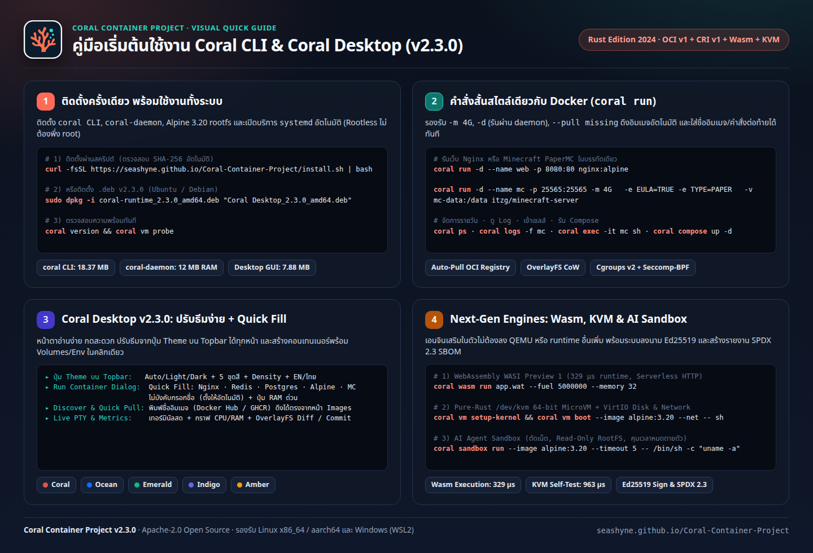
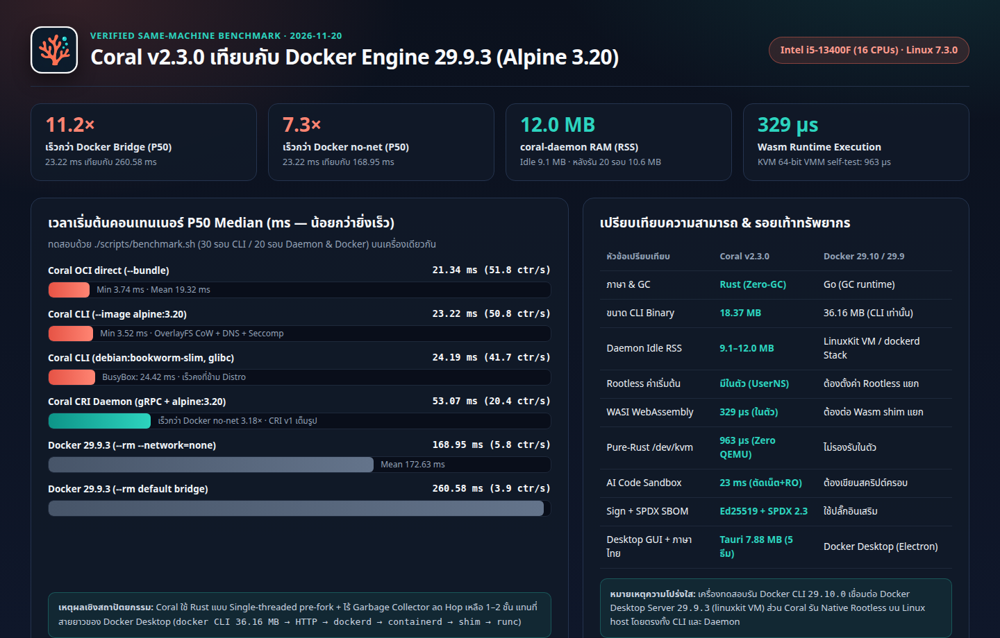

<p align="center">
  
</p>

<h1 align="center">Coral Container Project (<code>v2.3.0</code>)</h1>

**Coral** is a next-generation, memory-safe container runtime written in **Rust (Edition 2024)** — uniting a rootless-first **OCI v1.0.2** Linux container engine, **Kubernetes CRI v1 gRPC** daemon (TCP + `unix://` Unix Domain Socket + CNI plugin chain & streaming), **WASI Serverless HTTP WebAssembly** runtime (`coral-wasm`), pure-Rust Linux **`/dev/kvm` Separate-Kernel MicroVM with VirtIO-Blk & VirtIO-Net** (`coral-vmm`, Zero QEMU/Firecracker), **Prometheus `/metrics`**, **Ed25519 Image Signing + SPDX 2.3 SBOM**, multi-arch **x86_64 & ARM64**, and the redesigned **Coral Desktop** GUI (Linux / Windows / macOS `.dmg`).

> **Online Docs & Visual Guides:** https://seashyne.github.io/Coral-Container-Project/  
> **v2.3.0 Evaluation & Docker Benchmark Report:** [REPORT_v2.3.md](coral_repo/docs/REPORT_v2.3.md) · [BENCHMARK.md](coral_repo/docs/BENCHMARK.md)  
> **GitHub Releases (`.deb`, `.tar.gz`, Desktop installers):** https://github.com/seashyne/Coral-Container-Project/releases



---

## Highlights (`v2.3.0`)

- **Docker-Compatible `coral run` Ergonomics**: Run positional images & commands without boilerplate (`coral run -d -p 25565:25565 -m 4G -v mc-data:/data -e EULA=TRUE -e TYPE=PAPER itzg/minecraft-server`), human-friendly memory units (`-m 4G`, `512m`), `--pull missing|always|never` auto-pull, and `-d` auto-daemon routing.
- **Redesigned Coral Desktop GUI**: Crisp Design-Token CSS UI with Topbar **Theme Popover** (`System`/`Light`/`Dark`, 5 palettes: **Coral**, **Ocean**, **Emerald**, **Indigo**, **Amber**, Compact/Comfortable density, EN/ไทย switching), **Run Quick Fill** presets, inline **Discover & Quick Pull**, and automatic `~/.local/bin` discovery for desktop menu launches.
- **7.3×–11.2× Faster Startup than Docker on the Same Host**: `coral run --image alpine:3.20` starts rootlessly with OverlayFS CoW + DNS + Seccomp-BPF + Cap Drop in **23.22 ms P50** vs Docker Engine **168.95–260.58 ms P50**, with `coral-daemon` idle RAM at **9.1 MB**.
- **Real-World OCI & Kubernetes CRI v1**: Inherits full `ENTRYPOINT`/`CMD`/`ENV`/`WORKDIR`/`USER`, single-UID non-root remapping, UDS + CNI v1.0.0 chain + streaming `Exec`/`Attach`/`PortForward`, Prometheus `/metrics`, log rotation, Auto-GC, and `coral completion`.
- **WASI WebAssembly & Pure-Rust `/dev/kvm` MicroVM**: Execute WASI modules in **329 µs** (`coral-wasm`) and 64-bit `/dev/kvm` self-test in **963 µs** (`coral-vmm`) with persistent VirtIO-Blk + VirtIO-Net, Ed25519 signing, and SPDX 2.3 SBOM.



---

## Quick Install

> **Platform support:** the Coral engine (`coral`, `coral-daemon`) runs on **Linux only** — it is
> built directly on Linux syscalls, user namespaces and cgroups. **x86_64 and arm64 (ARM64) are
> both supported**, and CI builds and runs the full E2E suite on both architectures. The
> **Coral Desktop** GUI is a separate client and is available for Linux, Windows and macOS;
> it controls a Coral daemon and does not make the engine portable to those platforms.
> The hardware **`/dev/kvm` MicroVM and the AI Agent Sandbox are x86_64-only**; every other
> feature (OCI, CRI, CNI, images, signing, SBOM, WASM) works on arm64 as well.

### One-Liner (Linux x86_64 / arm64)

```bash
curl -fsSL https://seashyne.github.io/Coral-Container-Project/install.sh | bash
```

### Debian / Ubuntu `.deb`

Download the package matching your architecture — `coral-runtime_2.3.0_amd64.deb` (x86_64) or
`coral-runtime_2.3.0_arm64.deb` (arm64) — and the `Coral Desktop` installer from
[Releases](https://github.com/seashyne/Coral-Container-Project/releases/latest), then run:

```bash
sudo dpkg -i coral-runtime_2.3.0_amd64.deb    # or ..._arm64.deb
systemctl --user enable --now coral-daemon.service
coral version
```

### Build from Source (Linux)

```bash
git clone https://github.com/seashyne/Coral-Container-Project.git
cd Coral-Container-Project/coral_repo
./install.sh        # builds --release, installs to ~/.local/bin, enables coral-daemon.service
./verify.sh         # runs full 60-test OCI + CRI + Wasm + KVM E2E suite + strict Clippy
```

---

## Try Coral v2.0 in 30 Seconds

```bash
# Run an isolated rootless Alpine container with resource limits
coral run --memory 64m --pids-limit 64 alpine:3.20 /bin/sh -c 'echo "PID=$$ host=$(hostname)"'

# Probe real hardware /dev/kvm 64-bit MicroVM boot latency
coral vm probe

# Run a WASI Preview 1 WebAssembly module with fuel & RAM caps
coral wasm run app.wasm --fuel 5000000 --memory-mb 32

# Execute untrusted AI-generated code in a zero-network read-only sandbox
coral sandbox run --image alpine:3.20 --timeout 5 -- /bin/sh -c 'echo "Safe sandbox PID=$$"'
```

---

## Monorepo Layout

```text
.
├── Makefile             # Unified workspace commands (`make build`, `make verify`, `make desktop-dev`)
├── coral_repo/          # 10-crate Rust workspace (OCI, CRI v1 gRPC, Wasm, KVM VMM)
│   ├── api/             # [coral-api] Kubernetes CRI v1 Protobuf & Tonic gRPC bindings
│   ├── pkg/             # oci, cgroups, networking, runtime, wasm, vmm
│   ├── cmd/             # coral-cli (`coral`) + coral-daemon
│   ├── tests/           # Unit, OCI, Docker-parity, CRI, Wasm & KVM E2E tests
│   ├── scripts/         # setup-rootfs.sh, package-deb.sh, benchmark.sh, push_coral.sh
│   └── docs/            # ARCHITECTURE.md, ROADMAP.md, MANUAL.md, BENCHMARK.md
├── desktop/             # Tauri v2 Coral Desktop GUI (Theme/Token CSS, EN/TH i18n, Linux/Win/macOS)
├── docs/                # GitHub Pages Docs website (TH/EN, install guides, sponsor cards)
├── tools/               # Shared build tooling (HTML partial assembler)
├── infra/               # Containerized build Dockerfile & compose
└── .github/workflows/   # CI/CD: release.yml, desktop.yml, pages.yml
```

Both frontends (Desktop shell and Docs page) are assembled from small partials by a
dependency-free Node script (`tools/html-assembler.mjs`); the generated `index.html`
files are build artifacts and are not committed. `./check-line-limit.sh` keeps every
source file under 400 lines.

---

## Support the Project

If Coral saves you time or helps your team build safer, faster containers and AI sandboxes, consider supporting ongoing development via the [Sponsor / Donate section on the Docs site](https://seashyne.github.io/Coral-Container-Project/#support).

## License

Licensed under the [Apache License, Version 2.0](LICENSE).
