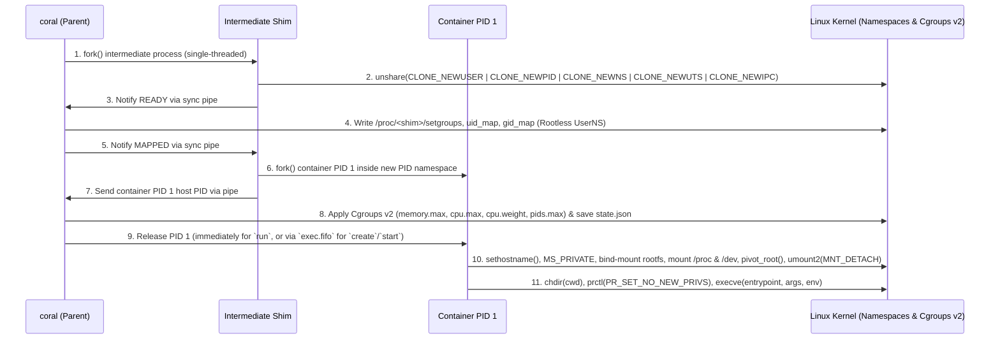

# Coral Container Runtime — System Architecture (v1.0)

Coral is a modular, memory-safe Linux container runtime and Kubernetes CRI v1 daemon written in Rust (Edition 2024). It follows the same clean separation of concerns as `containerd` (high-level CRI daemon) and `runc` / `youki` (low-level OCI runtime), unified inside a single Cargo workspace.

## 1. Standardized Workspace Layout

```text
coral_repo/
├── Cargo.toml                 # Rust Workspace root (shared dependencies & v1.0.0 metadata)
├── api/                       # [coral-api] Kubernetes CRI v1 Protobuf & Tonic gRPC bindings
│   ├── proto/cri.proto        # RuntimeService & ImageService definitions
│   ├── build.rs               # Automated compilation via vendored protoc (zero system dependency)
│   └── src/lib.rs
├── pkg/                       # Core Runtime Libraries
│   ├── oci/                   # [coral-oci] OCI Runtime Spec v1.0.2 parser, validator & state.json
│   ├── cgroups/               # [coral-cgroups] Linux Cgroups v2 controller (Memory, CPU, PIDs, stats)
│   ├── networking/            # [coral-net] CNI v1.0.0 network config & NetNS loopback initialization
│   └── runtime/               # [coral-runtime] Core Linux container engine
│       └── src/
│           ├── container.rs   # Double-fork + sync-pipe lifecycle, exec.fifo split create/start
│           ├── namespace.rs   # Root & Rootless UserNS (uid_map/gid_map) + PID/UTS/IPC/Mount/Net
│           ├── rootfs.rs      # MS_PRIVATE propagation, safe pivot_root + MNT_DETACH, /proc & /dev
│           └── store.rs       # Atomic state.json persistence & PID liveness reconciliation
├── cmd/                       # Executable Entry Points
│   ├── coral-cli/             # [coral] Single-threaded OCI CLI + CRI gRPC version client
│   └── coral-daemon/          # [coral-daemon] Async Tokio + Tonic CRI v1 gRPC Server
├── tests/                     # [coral-e2e-tests] Real Alpine Linux OCI & CRI v1 gRPC E2E test suite
├── scripts/
│   └── setup-rootfs.sh        # Automated Alpine Linux 3.20 minirootfs bootstrapper
├── docs/                      # Architecture, Roadmap, and User/Developer Manual
├── config.json                # Default OCI Runtime Spec v1.0.2 bundle configuration
└── verify.sh                  # Full quality-gate verifier (build + test + clippy + live run)
```

## 2. Container Execution Lifecycle (`coral-runtime`)



## 3. Why Single-Threaded `coral` + Multi-Threaded `coral-daemon`?

In POSIX systems, calling `fork()` inside a multi-threaded process (such as a Tokio async runtime) and performing memory allocations before `execve()` can deadlock if another thread holds a lock. Coral avoids this completely:

1. **`coral-daemon`** runs an asynchronous multi-threaded Tokio + Tonic gRPC server implementing Kubernetes CRI v1 (`RuntimeService` and `ImageService`).
2. When `StartContainer` or `ExecSync` is invoked over gRPC, `coral-daemon` generates an OCI bundle (`config.json`) and invokes the **`coral`** binary via `tokio::process::Command`.
3. **`coral`** starts as a clean single-threaded process, executes the double-fork + namespace + Cgroups v2 + `pivot_root` pipeline safely, and runs the target container workload.
