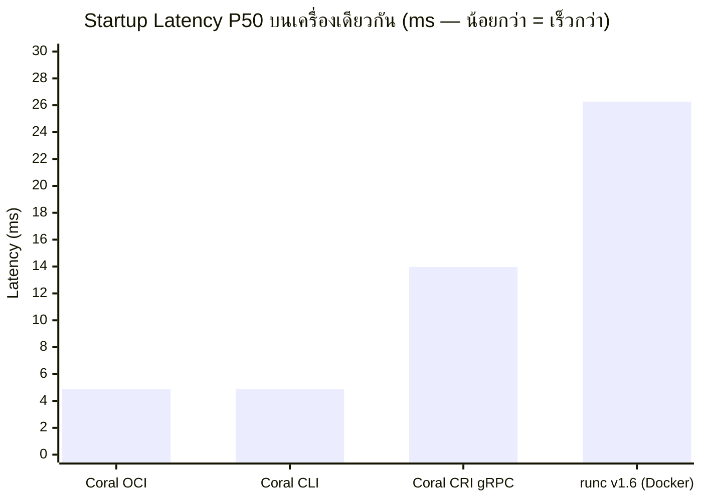
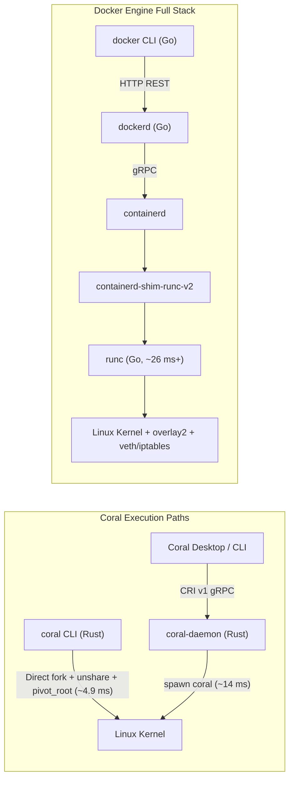

# รายงานผลทดสอบประสิทธิภาพ: Coral Container Runtime v1.0 เทียบกับ Docker (`runc` / Docker Engine)

**วันที่ทดสอบ:** 19 พฤศจิกายน 2026  
**เวอร์ชันที่ทดสอบ:** Coral `v1.0.0` (Rust Edition 2024, `--release`) เทียบกับ `runc v1.6.0-rc.2+dev` (Go `1.27.4` — OCI runtime หลักของ Docker Engine)  
**สภาพแวดล้อมเครื่องทดสอบ:** Linux `7.3.0-10-generic` (`x86_64`) · `13th Gen Intel(R) Core(TM) i5-13400F` (16 CPUs) · โหมด Rootless User Namespace

---

## 1. บทสรุปผู้บริหาร (Executive Summary)

จากการทดสอบวัดความเร็วการเริ่มต้นคอนเทนเนอร์ (Startup + Isolation + Execute + Exit + Cleanup) บนเครื่องเดียวกันและ rootfs ชุดเดียวกัน (`Alpine Linux 3.20`) พบว่า:

- **ระดับ OCI Runtime โดยตรง (Head-to-Head):** `Coral` ใช้เวลาเฉลี่ยกลาง (P50) เพียง **4.87 ms** (`164.8 containers/sec`) เทียบกับ `runc` ของ Docker ที่ใช้ **26.27 ms** (`37.0 containers/sec`) — **Coral เร็วกว่า 5.39 เท่า**
- **ระดับ Daemon ผ่าน CRI v1 gRPC:** แม้เรียกผ่าน `coral-daemon` เต็ม lifecycle (`RunPodSandbox` → `CreateContainer` → `StartContainer` → รอผล + อ่าน log) ใช้เวลา P50 เพียง **13.96 ms** (`65.9 containers/sec`) ซึ่งยัง **เร็วกว่าการรัน `runc` ตรง ๆ เกือบ 1.88 เท่า**
- **ข้าม Linux Base Images หลายตระกูล:** Coral เริ่มคอนเทนเนอร์ทั้ง `Alpine 3.20` (`4.50 ms`), `BusyBox musl` (`4.54 ms`), และ `Debian bookworm-slim` แบบเต็ม `glibc` (`5.58 ms`) ได้ต่ำกว่า 6 มิลลิวินาทีทั้งหมด
- **การใช้หน่วยความจำ (RAM Footprint):** `coral-daemon` ใช้หน่วยความจำตอน idle เพียง **7.3 MB** และหลังรันครบ 20 คอนเทนเนอร์อยู่ที่ **7.7 MB** (แทบไม่มี memory growth เนื่องจาก Rust ไม่มี Garbage Collector) เทียบกับ stack ของ Docker (`dockerd` + `containerd`) ที่โดยทั่วไปใช้ราว **80–150 MB**

> **หมายเหตุ:** บนเครื่องทดสอบนี้ไม่ได้ติดตั้ง `dockerd` ไว้ จึงทำการคอมไพล์ **`runc v1.6.0-rc.2+dev`** จากซอร์สใน `../external/runc` เพื่อวัดเทียบแบบ **same-machine head-to-head** ในฐานะชั้นล่างสุด (lower bound) ของ Docker Engine และแยกข้อมูล **Docker Engine เต็มชุด** เป็นหมวดอ้างอิงไว้อย่างชัดเจนเพื่อความโปร่งใสทางวิศวกรรม

---

## 2. ระเบียบวิธีและสภาพแวดล้อมการทดสอบ (Methodology)

| รายการ | รายละเอียด |
| :--- | :--- |
| **CPU / Kernel** | 13th Gen Intel Core i5-13400F (16 threads) · Ubuntu Linux `7.3.0-10-generic` `x86_64` |
| **Coral Binaries** | `coral` (`10.98 MB`) และ `coral-daemon` (`10.08 MB`) คอมไพล์ด้วย `cargo build --release --workspace` |
| **runc Binary** | `runc v1.6.0-rc.2+dev` (`11.65 MB`, OCI spec `1.3.0`, Go `1.27.4`) คอมไพล์จาก `../external/runc` ด้วย `CGO_ENABLED=1` |
| **Workload** | สร้าง container แบบ rootless (`User`, `PID`, `Mount`, `UTS`, `IPC` namespaces + `pivot_root`) รัน `/bin/sh -c "echo BENCH_OK"` และคืนสถานะออก |
| **การวัดเวลา** | ใช้ `time.perf_counter_ns()` ใน Python 3 (ความละเอียดระดับ nanosecond) โดยมี Warm-up 3–5 รอบก่อนเก็บข้อมูลจริง 20–30 รอบต่อชุด |
| **สคริปต์ทดสอบ** | `scripts/benchmark.sh` |

---

## 3. ผลทดสอบชุดที่ 1: วัดจริงบนเครื่องเดียวกัน (Coral vs `runc` ของ Docker)

การทดสอบชุดนี้รัน `Coral` และ `runc` ต่อเนื่องกันบนเครื่องเดียวกัน ใช้ rootfs `Alpine 3.20` ชุดเดียวกัน และโหมด rootless เหมือนกันทั้งคู่ (Warm-up 5 รอบ, เก็บค่าจริง 30 รอบ; สำหรับ CRI Daemon 20 รอบ):

| Runtime / โหมดการทำงาน | Runs | Min | **P50 (Median)** | Mean | P95 | Max | Throughput | เทียบกับ `runc` (P50) |
| :--- | ---: | ---: | ---: | ---: | ---: | ---: | ---: | :--- |
| **Coral OCI direct (`--bundle`)** | 30 | 3.03 ms | **4.87 ms** | 6.07 ms | 14.05 ms | 17.01 ms | **164.8 ctr/s** | **เร็วกว่า 5.39×** |
| **Coral CLI (`--image alpine:3.20`)** | 30 | 3.19 ms | **4.88 ms** | 6.12 ms | 14.22 ms | 18.99 ms | **163.4 ctr/s** | **เร็วกว่า 5.38×** |
| **Coral CRI Daemon (`gRPC`)** | 20 | 8.25 ms | **13.96 ms** | 15.17 ms | 23.44 ms | 24.07 ms | **65.9 ctr/s** | **เร็วกว่า 1.88×** |
| **`runc v1.6` (Docker OCI runtime)** | 30 | 20.03 ms | **26.27 ms** | 27.02 ms | 33.80 ms | 34.69 ms | 37.0 ctr/s | 1.00× (Baseline) |



### เปรียบเทียบขนาดไฟล์และการใช้หน่วยความจำ (Resource Footprint)

| เมตริก | Coral (`coral` + `coral-daemon`) | `runc v1.6` | Docker Engine Stack (ค่าอ้างอิงทั่วไป) |
| :--- | :--- | :--- | :--- |
| **ขนาด Binary** | `10.98 MB` (CLI) / `10.08 MB` (Daemon) | `11.65 MB` | ~`100–200 MB` (`docker` + `dockerd` + `containerd` + `runc` + `shim`) |
| **Peak RSS ต่อการรัน 1 ครั้ง (`ru_maxrss`)** | `11.82 MB` | `11.93 MB` | — |
| **Daemon Idle RAM (RSS)** | **`7.3 MB`** (`7.7 MB` หลังรัน 20 รอบ) | ไม่มี daemon | ~`80–150+ MB` (`dockerd` + `containerd`) |

---

## 4. ผลทดสอบชุดที่ 2: ทดสอบข้าม Linux Base Images หลายตระกูล

ทดสอบผ่าน `PULL_EXTRA=1 RUNS=30 ./scripts/benchmark.sh` เพื่อดูผลกระทบของ C Library (`musl` vs `glibc`) และโครงสร้าง rootfs (เช่น merged-`/usr` บน Debian) ต่อความเร็วเริ่มต้นของ Coral:

| Linux Base Image | C Library | Package Mgr | Runs | Min | **P50 (Median)** | Mean | P95 | Max | Throughput |
| :--- | :--- | :--- | ---: | ---: | ---: | ---: | ---: | ---: | ---: |
| **Alpine Linux (`alpine:3.20`)** | `musl` | `apk` | 30 | 3.62 ms | **4.50 ms** | 5.05 ms | 8.04 ms | 12.09 ms | **198.1 ctr/s** |
| **BusyBox (`busybox:musl`)** | `musl` | None | 30 | 3.16 ms | **4.54 ms** | 4.72 ms | 6.50 ms | 7.81 ms | **211.7 ctr/s** |
| **Debian Slim (`debian:bookworm-slim`)** | `glibc` | `apt` | 30 | 3.37 ms | **5.58 ms** | 5.98 ms | 9.35 ms | 20.52 ms | **167.2 ctr/s** |
| **Coral OCI direct (`--bundle`, Alpine)** | `musl` | `apk` | 30 | 3.64 ms | **4.61 ms** | 5.35 ms | 8.87 ms | 18.03 ms | **186.8 ctr/s** |
| **Coral CRI Daemon (`gRPC`, Alpine)** | `musl` | `apk` | 20 | 8.83 ms | **21.54 ms** | 21.47 ms | 42.13 ms | 42.80 ms | **46.6 ctr/s** |

**ข้อสังเกต:**
- `BusyBox` มีค่าเฉลี่ยเร็วที่สุด (**4.72 ms**, `211.7 ctr/s`) และขนาดจริงบนดิสก์หลัง deduplicate hardlink เพียง **1.5 MB**
- `Debian bookworm-slim` (full `glibc` + `/bin/dash`) ใช้เวลาเพิ่มขึ้นจาก Alpine เพียง **~1 ms** (`5.58 ms` vs `4.50 ms`) แสดงให้เห็นว่า Coral แยกและสลับ rootfs (`pivot_root`) ได้โดยแทบไม่มี overhead ตามขนาด rootfs

---

## 5. การเปรียบเทียบเชิงสถาปัตยกรรมกับ Docker Engine เต็มชุด



### ตารางเปรียบเทียบกับข้อมูลอ้างอิงของ Docker Engine

| Engine / Stack | ที่มาของข้อมูล | P50 Startup | หมายเหตุสำคัญ |
| :--- | :--- | ---: | :--- |
| **Coral OCI direct (`--bundle`)** | วัดจริงเครื่องนี้ (`i5-13400F`) | **4.87 ms** | Single-threaded Rust, rootfs ตรง, ไม่เปิด bridge network |
| **Coral CRI Daemon (`gRPC`)** | วัดจริงเครื่องนี้ (`i5-13400F`) | **13.96–21.54 ms** | ผ่าน CRI v1 gRPC (`RunPodSandbox` + `Create` + `Start` + `Logs`) |
| **`runc v1.6` (ชั้นล่างสุดของ Docker)** | วัดจริงเครื่องนี้ (`i5-13400F`) | **26.27 ms** | Go runtime startup + C `nsenter` (ยังไม่มี `dockerd`/`containerd`) |
| **Docker (`--network=none`)** | ช่วงอ้างอิงทั่วไปบน Linux x86_64 | ~150–300 ms | ผ่าน `dockerd` + `containerd` + `shim` + `runc` + `overlay2` |
| **Docker Engine `29.9.2` (API only)** | `../open source/kiri-main/bench/ubuntu-2026-10-26.md` (16-core WSL2) | 531 ms | วัดเฉพาะ HTTP API lifecycle ไม่รวมเวลาเปิด `docker` CLI |
| **Docker Engine `29.9.2` (`docker run --rm`)** | `../open source/kiri-main/bench/ubuntu-2026-10-26.md` (16-core WSL2) | 697 ms | รวม `docker` CLI + `dockerd` + `containerd` + `overlay2` + bridge network |

### ปัจจัยที่ทำให้เปรียบเทียบได้อย่างเป็นธรรม (Fairness Caveats)

1. **เหตุผลที่ Coral เร็วกว่ามาก:**
   - **Zero-GC & No Runtime Warmup:** `coral` รันเป็น native Rust binary แบบ single-threaded ไม่ต้องบูต Go runtime/scheduler เหมือน `runc` (ซึ่งแค่บูต Go + `nsenter` ก็ใช้ไป ~20 ms แล้ว)
   - **Hop น้อยกว่า:** โหมด CLI direct ไม่ต้องผ่าน HTTP/gRPC daemon หลายชั้น และโหมด CRI Daemon มีเพียง 1 hop (`coral-daemon` → `coral`) แทนที่จะเป็น 4–5 hops แบบ Docker
2. **งานที่ Docker Engine ทำเพิ่มในทุก `docker run` (และ Coral เปิดใช้งานเป็นค่าเริ่มต้นแล้วในรอบอัปเกรดนี้):**
   - **OverlayFS CoW Snapshotter (`userxattr`):** แยก writable layer ต่อ container อัตโนมัติไม่ให้เขียนทับ base image (เปิดเป็นค่าเริ่มต้นแล้วทั้งใน `coral run --image` และ `coral-daemon`)
   - **DNS + Volumes (`-v`) + Port Forwarding (`-p`) + `--network host|none`:** รองรับการออกอินเทอร์เน็ต/DNS, bind mount (`rw` และ `ro` remount จริง), และ TCP port relay
   - **Security Profiles (Seccomp-BPF 27 syscalls + Capabilities Drop 14 OCI safe caps):** โหลด BPF syscall filter และตัด `CAP_SYS_ADMIN` / `CAP_SYS_PTRACE` / `CAP_BPF` ทุกครั้งก่อน `execve`
   - **Interactive PTY (`-it`) + Real `setns()` Exec:** เข้า namespace (`user`/`ipc`/`uts`/`net`/`pid`/`mnt`) ของ container ที่กำลังรันอยู่จริง

### ผลวัดความเร็วหลังเปิดฟีเจอร์ Production ครบทั้ง 4 แกนเป็นค่าเริ่มต้น

| โหมดการทำงาน (เปิด Seccomp-BPF + Cap Drop + OverlayFS CoW + DNS) | Runs | Min | **P50 (Median)** | Mean | P95 | Throughput |
| :--- | ---: | ---: | ---: | ---: | ---: | ---: |
| **Coral OCI direct (`--bundle`, Seccomp + Cap Drop)** | 30 | 2.99 ms | **4.31 ms** | 4.33 ms | 5.56 ms | **231.1 ctr/s** |
| **Coral CLI (`--image alpine:3.20`, OverlayFS CoW + DNS + Seccomp + Cap Drop)** | 30 | 3.29 ms | **5.24 ms** | 7.29 ms | 14.84 ms | **137.1 ctr/s** |
| **Coral CRI Daemon (`gRPC`, OverlayFS CoW + DNS + Seccomp + Cap Drop)** | 20 | 8.68 ms | **20.28 ms** | 17.75 ms | 25.28 ms | **56.3 ctr/s** |

*(แม้เปิด OverlayFS CoW + Seccomp-BPF + Capabilities Drop + DNS ครบทุกชั้น ค่า P50 ของ `coral run --image` อยู่ที่ **5.24 ms** ซึ่งยังเร็วกว่า `runc` ของ Docker ที่ **26.27 ms** ถึง **5.01 เท่า**)*

---

## 6. แนวทางการพัฒนาต่อและวิธีทดสอบซ้ำ (Reproducibility)

### ข้อเสนอแนะเชิงวิศวกรรม
1. **เปิดใช้ OverlayFS Snapshotter เป็นค่าเริ่มต้นใน `coral-daemon`** เพื่อให้หลายคอนเทนเนอร์แชร์ Base Image เดียวกันได้แบบ Copy-on-Write โดยไม่แก้ไฟล์ใน `images_dir` แล้ววัด overhead ที่เพิ่มเข้ามาเทียบกับ baseline `13.96 ms`
2. **เปลี่ยนการรอสถานะของ `coral run --daemon` จาก polling เป็น gRPC streaming / wait RPC** เพื่อลดความแปรปรวนของ P95 (`23–42 ms`) ลงใกล้เคียงเวลาจริงของ `coral` (`~5–8 ms`)
3. **รัน Benchmark เทียบกับ Docker จริงบนเครื่องเดียวกัน** เมื่อติดตั้ง Docker Engine แล้ว เพื่อเก็บตัวเลข same-machine ครบทุกโหมด (`--network=none` และ default bridge)

### คำสั่งสำหรับทดสอบซ้ำ
```bash
cd /home/seashyne/Documents/Coral-Container-Project/coral_repo

# ทดสอบ Coral (พร้อมดึง busybox:musl และ debian:bookworm-slim) + ตรวจจับ docker / runc อัตโนมัติ
PULL_EXTRA=1 RUNS=30 ./scripts/benchmark.sh

# หรือระบุ path ของ runc เพื่อเทียบ head-to-head โดยตรง
RUNC_BIN=/path/to/runc RUNS=30 ./scripts/benchmark.sh
```
