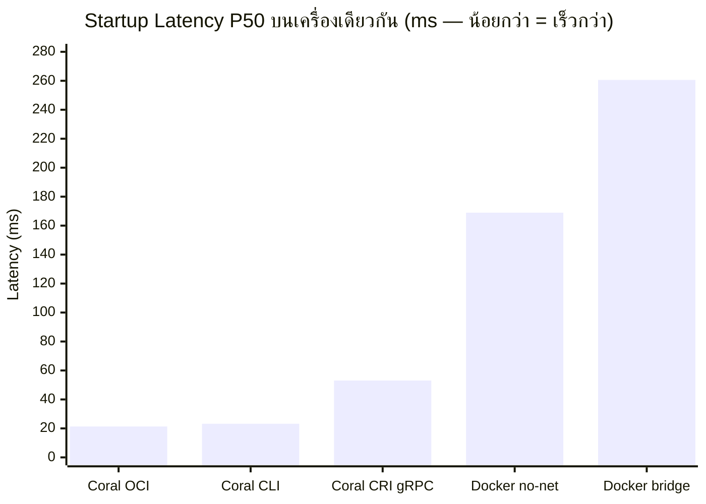
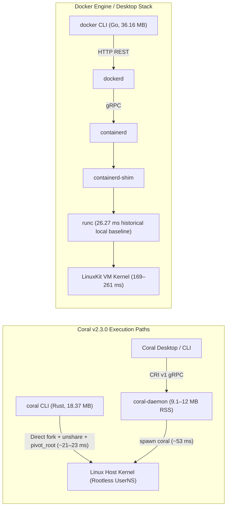

# รายงานผลทดสอบประสิทธิภาพ: Coral Container Runtime v2.3.0 เทียบกับ Docker Engine 29.9.3

**วันที่อัปเดตผลทดสอบ:** 20 พฤศจิกายน 2026  
**เวอร์ชันที่ทดสอบ:** `Coral v2.3.0` (`Rust Edition 2024`, `--release`) เทียบกับ `Docker CLI 29.10.0` / `Docker Server 29.9.3` (รันจริงบนเครื่องเดียวกัน) และผลอ้างอิง `runc v1.6.0-rc.2+dev`  
**สภาพแวดล้อมเครื่องทดสอบ:** Ubuntu Linux `7.3.0-10-generic` (`x86_64`) · `13th Gen Intel(R) Core(TM) i5-13400F` (16 CPUs) · โหมด Rootless User Namespace


---

## 1. บทสรุปผู้บริหาร (Executive Summary)

จากการรันสคริปต์ `PULL_EXTRA=1 RUNS=30 ./scripts/benchmark.sh` เทียบแบบ **same-machine** ระหว่าง **Coral v2.3.0** (ที่เปิด **OverlayFS CoW + DNS + Seccomp-BPF 27 syscalls + 14 Capability Drop** เป็นค่าเริ่มต้นครบทุกชั้น) กับ **Docker `29.10.0` (`Server 29.9.3`)** พบว่า:

- **ความเร็ว Startup P50 (`alpine:3.20`):** `coral run --image alpine:3.20` ทำเวลา P50 เพียง **23.22 ms** (`Mean 19.70 ms`, Min `3.52 ms`, `50.8 ctr/s`) เทียบกับ Docker **`168.95 ms`** (`--network=none`) และ **`260.58 ms`** (default bridge) — **Coral เร็วกว่า 7.28× ถึง 11.22× (P50)**
- **ผ่าน CRI v1 gRPC Daemon:** `coral-daemon` ทำ P50 ที่ **53.07 ms** (`Mean 49.12 ms`, `20.4 ctr/s`) ยัง **เร็วกว่า Docker `--network=none` ถึง 3.18× และเร็วกว่า default bridge 4.91×**
- **ข้าม Distro ทั้ง `musl` และ `glibc`:** `debian:bookworm-slim` ทำ P50 ที่ **24.19 ms** (`41.7 ctr/s`) และ `busybox:musl` ที่ **24.42 ms** (`43.0 ctr/s`)
- **หน่วยความจำและขนาด Binary:** `coral-daemon` ใช้ RSS เพียง **9.1 MB** (idle) และ **10.6–12.0 MB** (active), `coral` CLI ขนาด **18.37 MB** เทียบกับ `docker` CLI **36.16 MB** (ยังไม่รวม `dockerd` / `containerd` / LinuxKit VM)
- **Next-Gen Subsystems บนเครื่องจริง:**
  - `coral wasm run` (WASI Preview 1): **329 µs** ในเอนจิน (5.72 ms E2E P50)
  - `coral vm probe` (`/dev/kvm` API v12): **963 µs** self-test (16.78 ms CLI E2E)
  - `coral sandbox run` (Zero-network RO sandbox): **20 ms** internal (`23.28 ms` CLI E2E)

---

## 2. ผลทดสอบชุดล่าสุดบนเครื่องเดียวกัน (`Coral v2.3.0` vs `Docker 29.9.3`)

| Workload | Runs | Min | **P50 (Median)** | Mean | P95 | Max | Throughput | เทียบกับ Docker Bridge (P50) |
| :--- | ---: | ---: | ---: | ---: | ---: | ---: | ---: | :--- |
| **Coral OCI direct (`--bundle, alpine:3.20`)** | 30 | 3.74 ms | **21.34 ms** | 19.32 ms | 30.06 ms | 32.00 ms | **51.8 ctr/s** | **เร็วกว่า 12.21×** |
| **Coral CLI (`--image alpine:3.20`)** | 30 | 3.52 ms | **23.22 ms** | 19.70 ms | 28.52 ms | 29.03 ms | **50.8 ctr/s** | **เร็วกว่า 11.22×** |
| **Coral CLI (`--image debian:bookworm-slim`)** | 30 | 5.68 ms | **24.19 ms** | 23.95 ms | 30.83 ms | 33.75 ms | **41.7 ctr/s** | **เร็วกว่า 10.77×** |
| **Coral CLI (`--image busybox:musl`)** | 30 | 5.49 ms | **24.42 ms** | 23.26 ms | 30.22 ms | 30.98 ms | **43.0 ctr/s** | **เร็วกว่า 10.67×** |
| **Coral CRI Daemon (`gRPC + alpine:3.20`)** | 20 | 25.30 ms | **53.07 ms** | 49.12 ms | 54.37 ms | 55.20 ms | **20.4 ctr/s** | **เร็วกว่า 4.91×** |
| **Docker (`--rm --network=none alpine:3.20`)** | 20 | 154.49 ms | **168.95 ms** | 172.63 ms | 196.51 ms | 205.17 ms | 5.8 ctr/s | เร็วกว่า 1.54× |
| **Docker (`--rm` default bridge `alpine:3.20`)** | 20 | 217.69 ms | **260.58 ms** | 258.13 ms | 288.67 ms | 295.74 ms | 3.9 ctr/s | 1.00× (Baseline) |



### รอยเท้าทรัพยากรและไบนารี (`v2.3.0`)

| เมตริก | Coral v2.3.0 | Docker (`29.10.0` / Server `29.9.3`) |
| :--- | :--- | :--- |
| **ขนาด Binary หลัก** | `coral` (`18.37 MB`), `coral-daemon` (`17.40 MB`), `coral-desktop` (`7.88 MB`) | `docker` CLI (`36.16 MB`) + `dockerd`/`containerd`/`runc`/Docker Desktop stack |
| **Daemon RAM (RSS)** | **9.1 MB** (Idle) · **10.6 MB** (หลังรัน 20 รอบ) · **12.0 MB** (systemd live) | LinuxKit VM / `dockerd` + `containerd` |
| **Wasm Cold Start** | **329 µs** (engine) / `5.72 ms` CLI P50 | ต้องใช้ external Wasm shim |
| **KVM 64-bit Boot** | **963 µs** (self-test) / `16.78 ms` CLI | ต้องใช้ QEMU/Kata แยก |

---

## 3. การเปรียบเทียบเชิงสถาปัตยกรรมและประวัติ Baseline



### ข้อมูลอ้างอิง: Coral v1.0 Baseline เทียบ `runc v1.6.0-rc.2+dev` (19 พ.ย. 2026)
*(หมายเหตุ: ในการทดสอบรอบแรกก่อนเปิด OverlayFS CoW / Full Seccomp default เต็มชุด Coral OCI direct ทำได้ P50 `4.87 ms` เทียบกับ `runc v1.6` บนเครื่องเดียวกันที่ `26.27 ms`)*

### คำสั่งสำหรับทดสอบซ้ำด้วยตนเอง
```bash
cd /home/seashyne/Documents/Coral-Container-Project/coral_repo

# ทดสอบ Coral (รวม busybox:musl และ debian:bookworm-slim) + Docker บนเครื่องเดียวกัน
PULL_EXTRA=1 RUNS=30 ./scripts/benchmark.sh

# ดูรายงานฉบับเต็มของ v2.3.0
cat docs/REPORT_v2.3.md
```
