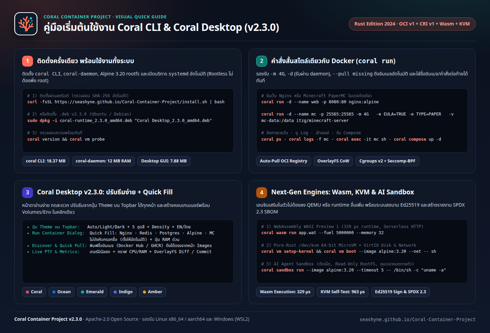

# คู่มือการใช้งานและพัฒนา Coral Container Runtime (`v2.9.1` Manual)

คู่มือนี้อธิบายขั้นตอนการติดตั้ง, การเตรียม Alpine Rootfs, การใช้งาน CLI (`coral`), การรันคอนเทนเนอร์สไตล์เดียวกับ Docker (`coral run`, `scan`, `top`, `wait`, `stats --all`, `pause`/`unpause`/`rename`/`update`), การใช้ **Coral Desktop v2.9.1**, CRI gRPC Daemon + Streaming `docker.sock` (`coral-daemon`), `coral machine`, Multi-Arch BuildKit DAG + `.dockerignore`, Rootless L2/L3 Virtual Switch + Outbound NAT + Upstream/Round-Robin Gateway DNS และ Quality Gates



---

## 1. การเตรียมสภาพแวดล้อมและติดตั้ง / Build โปรเจกต์

Coral ใช้ `protoc-bin-vendored` ในขั้นตอนการคอมไพล์ Protobuf จึง**ไม่จำเป็นต้องติดตั้ง `protobuf-compiler` ด้วย `sudo`** บนเครื่องโฮสต์

```bash
cd /home/seashyne/Documents/Coral-Container-Project/coral_repo

# ตัวเลือก A: บิลด์ release และติดตั้งลง ~/.local/bin + เปิด systemd user service
./install.sh

# ตัวเลือก B: พัฒนาและบิลด์แบบ debug
./scripts/setup-rootfs.sh
cargo build --workspace
```

Binary ที่ได้จะอยู่ที่ `~/.local/bin/` (หลังรัน `./install.sh`) หรือ `target/debug/`:
- `coral` — OCI & Docker-compatible Runtime CLI (`v2.3.0`)
- `coral-daemon` — Kubernetes CRI v1 gRPC Daemon (`v2.3.0`)
- `coral-desktop` — แอปจัดการแบบกราฟิก (Tauri v2)

### 1.1 คำสั่งสั้นสไตล์เดียวกับ Docker (`coral run v2.3.0`)

ตั้งแต่ `v2.3.0` สามารถรันอิมเมจจาก Docker Hub / GHCR ได้โดยตรงโดยไม่ต้องพิมพ์ `--image` หรือ `--`, รองรับ `-m 4G` / `64m`, `--pull missing|always|never` (ค่าเริ่มต้น `missing`) และ `-d` ส่งเข้า daemon อัตโนมัติ:

```bash
# รันเว็บเซิร์ฟเวอร์ Nginx
coral run -d --name web -p 8080:80 nginx:alpine

# รัน Minecraft Server (PaperMC) แบบ persistent volume
coral run -d --name mc-server \
  -p 25565:25565 \
  -m 4G \
  -e EULA=TRUE -e TYPE=PAPER -e VERSION=LATEST -e MEMORY=3G \
  -v mc-data:/data \
  --restart unless-stopped \
  itzg/minecraft-server

# ดูคอนเทนเนอร์, ติดตาม log สด, หรือเปิดเชลล์
coral ps
coral logs -f mc-server
coral exec -it mc-server /bin/sh
```

---

## 2. การใช้งาน `coral` CLI (OCI Runtime)

Coral รองรับทั้งการรันแบบ **Rootless** (ผู้ใช้ทั่วไป ไม่ต้องใช้ `sudo` โดยอาศัย Linux User Namespace) และการรันแบบ **Root** (`sudo`)

### 2.1 สร้างไฟล์มาตรฐาน OCI `config.json`
```bash
./target/debug/coral spec --rootless --rootfs rootfs --output config.json
```

### 2.2 รันคอนเทนเนอร์แบบ Foreground (`run`)
```bash
./target/debug/coral run --bundle . my-alpine-box
```

### 2.3 การแยกขั้นตอน `create` -> `state` -> `start` -> `list` -> `delete` (Split OCI Lifecycle)
```bash
# 1. สร้างคอนเทนเนอร์ในสถานะ 'created' (รอคำสั่ง start บน exec.fifo)
./target/debug/coral create --bundle . demo-1

# 2. ตรวจสอบสถานะตามมาตรฐาน OCI state.json
./target/debug/coral state demo-1

# 3. แสดงรายการคอนเทนเนอร์ทั้งหมด
./target/debug/coral list

# 4. สั่งให้คอนเทนเนอร์เริ่มรันโปรเซสจริง
./target/debug/coral start demo-1

# 5. อ่านค่าการใช้ทรัพยากรจาก Cgroups v2 (Memory / CPU / PIDs)
./target/debug/coral stats demo-1

# 6. ลบคอนเทนเนอร์เมื่อทำงานเสร็จ (หรือใส่ --force เพื่อบังคับหยุดและลบ)
./target/debug/coral delete --force demo-1
```

### 2.4 สร้างไฟล์คอนฟิกเครือข่ายมาตรฐาน CNI v1.0.0
```bash
./target/debug/coral cni-config
```

### 2.5 จัดการ Linux Base Images และรันคอนเทนเนอร์จาก Image (`catalog` / `pull` / `images` / `run --image` / `rmi`)
รองรับการดึง OCI Image จาก Docker Hub, Red Hat Registry, GHCR, หรือสร้าง `scratch` ได้ทั้งแบบทำงานร่วมกับ `coral-daemon` (เมื่อ daemon เปิดอยู่) และแบบ standalone (เก็บไว้ที่ `~/.local/state/coral/images` หรือปรับด้วย `--images-dir` / `CORAL_IMAGES_DIR`):

```bash
# ดูรายการ Linux Base Images ยอดนิยมทั้ง 7 ตัว พร้อมสถานะการติดตั้ง
./target/debug/coral catalog

# ดึง Base Image (เลือกได้ทั้ง Alpine, Debian Slim, Ubuntu, BusyBox, Rocky Linux, Red Hat UBI, scratch)
./target/debug/coral pull debian:bookworm-slim
./target/debug/coral pull ubuntu:24.04
./target/debug/coral pull busybox:musl
./target/debug/coral pull rockylinux:9-minimal
./target/debug/coral pull registry.access.redhat.com/ubi9/ubi-minimal:latest
./target/debug/coral pull scratch

# หรือ register โฟลเดอร์ rootfs ที่มีอยู่แล้วแบบออฟไลน์
./target/debug/coral pull my-alpine:local --rootfs ./rootfs

# ดูรายการ images ที่ติดตั้งและขนาดบนดิสก์
./target/debug/coral images

# รันคอนเทนเนอร์โดยตรงจาก image (เปิด OverlayFS CoW + DNS + Seccomp-BPF + Cap Drop เป็นค่าเริ่มต้น)
./target/debug/coral run --image debian:bookworm-slim -e HELLO=coral -m 128 --cpu 50 -- /bin/sh -c 'echo "$HELLO" && cat /etc/os-release'

# เข้า shell แบบโต้ตอบ (-it), bind volume หรือ named volume (-v), และ map port (-p)
./target/debug/coral run -it --image alpine:3.20 -v "$PWD:/workspace:ro" -p 8080:8000 -- /bin/sh

# รันในโหมด Isolated Bridge NetNS (แยก CLONE_NEWNET ต่อคอนเทนเนอร์ + Cross-NetNS Port Forwarding + Custom DNS/Hosts)
./target/debug/coral run --network bridge -p 8081:80 --dns 1.1.1.1 --add-host db.internal:10.0.0.5 --image alpine:3.20 -- /bin/sh

# รันแบบตัดขาดเครือข่าย (air-gapped loopback only)
./target/debug/coral run --network none --image busybox:musl -- /bin/sh -c "ip addr || cat /proc/net/dev"

# จัดการ Named Volumes (`~/.local/state/coral/volumes/<name>/_data`)
./target/debug/coral volume create app-data
./target/debug/coral volume ls
./target/debug/coral volume inspect app-data
./target/debug/coral run --image alpine:3.20 -v app-data:/data -- /bin/sh -c "echo hello > /data/msg.txt"
./target/debug/coral volume rm app-data

# ตรวจสอบไฟล์ที่เปลี่ยนแปลงในชั้น OverlayFS CoW (`A` เพิ่ม, `C` แก้ไข, `D` ลบ) และ Commit เป็น Image ใหม่
./target/debug/coral diff <CONTAINER_ID>
./target/debug/coral commit <CONTAINER_ID> my-custom-alpine:v1

# Build Image ใหม่จาก Dockerfile พร้อม Step Cache (`[CACHED]`, หรือใช้ `--no-cache`)
./target/debug/coral build -t my-service:v1 -f Dockerfile .

# Tag / Export (.tar, .tar.gz, .tar.zst) / Import Image แบบออฟไลน์ หรือ Login & Push ขึ้น OCI Registry
./target/debug/coral tag my-service:v1 ghcr.io/your-user/my-service:v1
./target/debug/coral login ghcr.io -u your-user --password-stdin < token.txt
./target/debug/coral push ghcr.io/your-user/my-service:v1
./target/debug/coral logout ghcr.io
./target/debug/coral save -o my-service.tar.zst my-service:v1
./target/debug/coral load -i my-service.tar.zst

# สร้างและจัดการ User-Defined Networks (รองรับ sibling hostname resolution + rootless egress เมื่อมี pasta/slirp4netns)
./target/debug/coral network create backend
./target/debug/coral network ls
./target/debug/coral run -d --network backend --name db --image alpine:3.20 -- /bin/sh -c "sleep 60"
./target/debug/coral network rm backend

# รัน WebAssembly (Wasm + WASI Preview 1) ระดับไมโครวินาทีโดยไม่ต้องมี Linux rootfs
./target/debug/coral wasm run ./hello.wat --fuel 5000000 --memory 16 --json
./target/debug/coral wasm pack ./hello.wat -t hello-wasm:v1
./target/debug/coral run --runtime wasm --image hello-wasm:v1

# ทดสอบ Native Linux /dev/kvm 64-bit MicroVM และรันโค้ดที่ไม่ไว้ใจใน AI Agent Sandbox
./target/debug/coral vm probe
./target/debug/coral sandbox run --image alpine:3.20 --timeout 5 --memory 64 --json -- /bin/sh -c "id && uname -a"

# จัดการ Multi-Container Stack ด้วย Compose (`coral-compose.yml` หรือ `docker-compose.yml`)
./target/debug/coral compose up -d
./target/debug/coral compose ps
./target/debug/coral compose logs
./target/debug/coral compose down -v

# เข้า Interactive Shell ของคอนเทนเนอร์ที่กำลังรันอยู่จริงด้วย setns() (ตรวจจับทั้ง local และ daemon อัตโนมัติ)
./target/debug/coral exec -it <CONTAINER_ID> -- /bin/sh

# ลบ image และโฟลเดอร์ rootfs ที่ Coral จัดการ
./target/debug/coral rmi debian:bookworm-slim
```

### 2.6 จัดการคอนเทนเนอร์และ Pod ผ่าน `coral-daemon` (CRI v1)
```bash
# รันคอนเทนเนอร์ผ่าน coral-daemon พร้อมนโยบาย Auto-Restart และ Healthcheck (จะเห็นใน Coral Desktop และ `coral ps` ทันที)
./target/debug/coral run -d --image alpine:3.20 --name demo \
  --restart on-failure:3 --health-cmd "test -f /tmp/ready" --health-interval 5 \
  -- /bin/sh -c "touch /tmp/ready && echo hi && sleep 30"

# ดูรายการคอนเทนเนอร์ (พร้อมสถานะ health) / ติดตาม log แบบเรียลไทม์ / ดูกราฟและสถิติ CPU & RAM สด
./target/debug/coral ps
./target/debug/coral inspect <CONTAINER_ID>
./target/debug/coral cp ./app.conf <CONTAINER_ID>:/etc/app.conf
./target/debug/coral cp <CONTAINER_ID>:/etc/app.conf ./downloaded.conf
./target/debug/coral logs <CONTAINER_ID> --status --tail 50 -f
./target/debug/coral stats <CONTAINER_ID> --watch --interval 1000
./target/debug/coral exec <CONTAINER_ID> -- /bin/cat /etc/alpine-release
./target/debug/coral stop <CONTAINER_ID>
./target/debug/coral rm <CONTAINER_ID>

# ดูพื้นที่ใช้จริงและล้างทรัพยากรที่ไม่ได้ใช้งาน
./target/debug/coral system df
./target/debug/coral system prune          # ล้าง exited containers, unused pods, build cache
./target/debug/coral system prune -a --volumes

# จัดการ Pod sandboxes
./target/debug/coral pods
./target/debug/coral pods stop <POD_ID>
./target/debug/coral pods rm <POD_ID>

# ตรวจสอบเวอร์ชัน CLI และสถานะ daemon
./target/debug/coral version
```

---

## 3. การใช้งาน `coral-daemon` (Kubernetes CRI v1 gRPC Server)

```bash
# รัน CRI v1 gRPC Server บนพอร์ต 50051 พร้อมลงทะเบียน Alpine rootfs เป็น image 'alpine:latest'
./target/debug/coral-daemon \
  --listen 127.0.0.1:50051 \
  --coral-bin ./target/debug/coral \
  --default-rootfs ./rootfs
```

ในอีก Terminal หนึ่ง สามารถใช้ `coral` ตรวจสอบเวอร์ชันผ่านโปรโตคอล CRI v1 gRPC ได้ทันที:
```bash
./target/debug/coral daemon-version --addr http://127.0.0.1:50051
# ผลลัพธ์: runtime=coral version=1.0.0 api=v1 cri=0.1.0
```

---

## 4. การตรวจสอบคุณภาพโค้ด (Quality Gates)

ก่อน Commit หรือ Push ทุกครั้ง ให้รันชุดตรวจสอบมาตรฐานของโปรเจกต์:

```bash
# รัน Unit Tests + OCI E2E Tests + CRI gRPC E2E Tests
cargo test --workspace

# ตรวจสอบความสะอาดของโค้ดด้วย Clippy (ไม่อนุญาตให้มี Warning)
cargo clippy --workspace --all-targets -- -D warnings

# หรือรันสคริปต์ตรวจสอบครบวงจรในคำสั่งเดียว
./verify.sh
```

---

## 5. ฟีเจอร์ระดับ Next-Gen & Deep-Tech (`v2.0` – `v2.2`)

### 5.1 Pure-Rust `/dev/kvm` Separate-Kernel Linux MicroVM + VirtIO-Blk & VirtIO-Net (Zero QEMU)
```bash
# ทดสอบฮาร์ดแวร์ /dev/kvm (VT-x/AMD-V) + 64-bit Long Mode self-test (~2.9 ms)
coral vm probe

# ดาวน์โหลด Guest Linux Kernel (Alpine 3.20 linux-virt) + แยก VirtIO/ext4 `.ko` modules อัตโนมัติ
coral vm setup-kernel

# สร้าง VirtIO-Blk disk image (ext4) แล้วบูต Linux 6.6 KVM พร้อม persistent storage + VirtIO-Net
coral vm disk create ./vmdata.img --size-mb 64 --ext4
coral vm boot --image alpine:3.20 --disk ./vmdata.img --disk-mount /mnt/data --net -p 8080:80 --timeout 15 -- \
  /bin/sh -c 'echo "Kernel=$(uname -r)"; ip -4 addr show eth0'

# รันโค้ดที่ไม่ไว้ใจใน AI Agent Sandbox (Air-gapped + Read-Only + Hard Process-Group Timeout)
coral sandbox run --image alpine:3.20 --timeout 5 --memory 64 --json -- /bin/sh -c 'echo "Safe PID=$$"'
```

### 5.2 WebAssembly WASI Preview 1 & Serverless HTTP (`coral-wasm`)
```bash
# รันไฟล์ .wasm / .wat ตรง ๆ พร้อมคุม CPU fuel และเพดาน RAM
coral wasm run app.wasm --fuel 5000000 --memory 32 --json

# แพ็ก .wasm เป็น OCI Image และรันผ่าน --runtime wasm
coral wasm pack app.wasm -t my-wasm:v1
coral run --runtime wasm my-wasm:v1

# เปิดเซิร์ฟเวอร์ HTTP/1.1 Serverless (สร้าง Wasm Sandbox แยกใหม่ทุก Request ใน ~89 µs)
coral wasm serve my-wasm:v1 --listen 127.0.0.1:8080 --fuel 10000000 --memory 32
```

### 5.3 Kubernetes CRI v1 Unix Domain Socket (`kubelet` / `crictl`)
```bash
# coral-daemon เปิดฟังทั้ง TCP (127.0.0.1:50051) และ Unix Socket (~/.local/state/coral/daemon/coral.sock) พร้อมกัน
coral-daemon --listen 127.0.0.1:50051 --unix-socket /run/coral/coral.sock

# ตรวจสอบสถานะ CRI v1 (RuntimeReady & NetworkReady) ผ่าน Unix Socket
coral --endpoint unix://$HOME/.local/state/coral/daemon/coral.sock cri-status --verbose
```

### 5.4 Supply-Chain Security: Ed25519 Signing & SPDX 2.3 SBOM
```bash
# สร้างคู่กุญแจ Ed25519 (~/.config/coral/cosign.key mode 0600 และ cosign.pub)
coral keygen

# ลงนาม Image ด้วย Ed25519 + SHA-256 Rootfs Merkle Tree Digest
coral sign alpine:3.20

# ตรวจสอบลายเซ็นและความถูกต้องของไฟล์ทุกไบต์ใน RootFS (แจ้งเตือนทันทีหากถูกดัดแปลง)
coral verify alpine:3.20

# สร้างรายงาน Software Bill of Materials มาตรฐาน SPDX 2.3 JSON (รองรับ APK, DPKG และ Wasm)
coral sbom alpine:3.20 -o alpine-sbom.spdx.json
```

### 5.5 Prometheus `/metrics`, Log Rotation, Auto-GC & Shell Autocomplete (`v2.2`)
```bash
# เปิด coral-daemon พร้อม Prometheus /metrics (ค่าเริ่มต้น 127.0.0.1:9108), Log Rotation และ Auto-GC
coral-daemon --metrics-listen 127.0.0.1:9108 --log-max-size-mb 10 --log-max-files 3 --auto-gc-interval-secs 300
curl -s http://127.0.0.1:9108/metrics | grep coral_

# ติดตั้ง Shell Autocomplete (รองรับ bash, zsh, fish, elvish, powershell)
coral completion bash | sudo tee /etc/bash_completion.d/coral >/dev/null
```

### 5.6 ฟีเจอร์ Docker-Parity ขั้นสูง (`v2.4.0`)
```bash
# 1. เชื่อมต่อเครื่องมือสาย Docker ผ่าน docker.sock (Testcontainers, Traefik, curl)
export DOCKER_HOST="unix://$HOME/.local/state/coral/daemon/docker.sock"
curl -s --unix-socket "$HOME/.local/state/coral/daemon/docker.sock" http://localhost/v1.45/version

# 2. ส่งต่อ GPU / อุปกรณ์เครื่องหลัก + Network Alias + Docker json-file / syslog log driver
coral run -d --name ai-worker --network app-net --network-alias inference \
  --gpus all --device /dev/dri:/dev/dri --log-driver json-file alpine:3.20 sleep 3600

# 3. สร้างอิมเมจด้วย BuildKit Heredoc และ RUN --mount=type=cache / secret
cat <<'DOCKERFILE' > Dockerfile
FROM alpine:3.20
EXPOSE 8080/tcp
HEALTHCHECK --interval=5s --retries=3 CMD test -f /app/ready
RUN --mount=type=cache,id=apk,target=/var/cache/apk --mount=type=secret,id=token,src=secret.txt <<EOF
mkdir -p /app
touch /app/ready
EOF
DOCKERFILE
coral build -t demo:v2.4 .
```

> ดูรายละเอียดเชิงลึกของแต่ละฟีเจอร์ (พฤติกรรม, ข้อจำกัด, ตัวเลือกทั้งหมด) ได้ที่ [หัวข้อ 7](#7-ฟีเจอร์เชิงแพลตฟอร์มระหว่างระบบ--รายละเอียดเชิงลึก-v240)

---

## 6. การใช้งาน Coral Desktop (`v2.4.0` GUI)

เปิดแอปผ่านเมนูแอปพลิเคชัน (**Coral Desktop**) หรือรัน `coral-desktop` โดยจุดเด่นของ `v2.4.0` ได้แก่:

1. **Topbar Theme Popover (`ปุ่ม Theme` ด้านขวาบน):**
   - คลิกที่ปุ่ม **Theme** เพื่อปรับได้ทันทีจากทุกหน้าจอโดยไม่ต้องสลับไปหน้า Settings:
     - **Color Mode:** `System (ตามระบบ)` / `Light` / `Dark`
     - **Accent Palette (5 ชุดสี):** `Coral`, `Ocean`, `Emerald`, `Indigo`, `Amber`
     - **Interface Density:** `Comfortable` / `Compact`
     - **Language:** `English` / `ไทย`
2. **สร้างคอนเทนเนอร์ง่าย (`Run container` → Quick Fill):**
   - กดแถบ **Quick Fill** ด้านบนของหน้าต่าง (`Nginx`, `Redis`, `PostgreSQL`, `Alpine Shell`, `Minecraft PaperMC`) เพื่อเติม Image, พอร์ต, Volumes, Env และ RAM ให้อัตโนมัติ
   - ช่อง **Container Name** สามารถเว้นว่างไว้ให้ระบบตั้งชื่อให้ได้ทันที
3. **ดึงอิมเมจได้ตรงจากหน้า Images (`Discover & Quick Pull`):**
   - พิมพ์ชื่ออิมเมจใดก็ได้ (เช่น `itzg/minecraft-server`, `postgres:16-alpine`, `ghcr.io/org/app:v1`) ในช่อง **Quick Pull Any OCI Image** ด้านบนสุด แล้วกด Pull ได้ในขั้นตอนเดียว
4. **Live Terminal (PTY), Logs & OverlayFS Diff:**
   - คลิกที่แถวคอนเทนเนอร์เพื่อเปิด Drawer ดู Logs แบบ Auto-scroll, เปิด Live PTY Terminal, ดูกราฟ CPU/RAM, และตรวจสอบไฟล์ OverlayFS diff พร้อม Commit เป็น Image ใหม่ได้ทันที

---

## 7. ฟีเจอร์เชิงแพลตฟอร์มระหว่างระบบ — รายละเอียดเชิงลึก (`v2.4.0`)

ฟีเจอร์ชุดนี้เพิ่มเข้ามาใน `v2.3.0` ทั้งหมดเขียนด้วย Rust ล้วน ไม่ต้องติดตั้ง daemon ภายนอกเพิ่ม และมี E2E test ครอบคลุม

### 7.1 Content-Addressable Layer Cache (แคชชั้นข้อมูลตาม digest)

`coral pull` จะไม่ดาวน์โหลด layer ที่เคยมีอยู่แล้วอีก — blob ที่ผ่านการตรวจสอบจะถูกเก็บแบบ content-addressable ตาม OCI digest ที่ `<images_dir>/.layer-cache/sha256/<hex>.blob` และถูกใช้ซ้ำโดย image อื่นที่อ้างอิง layer เดียวกัน

- **ตรวจสอบ SHA-256 สองครั้ง** — ตอนดาวน์โหลด และอีกครั้งทุกครั้งที่อ่านจากแคช หาก digest ไม่ตรงกัน ไฟล์นั้นจะถูกลบทิ้งอัตโนมัติแทนที่จะถูกนำไปใช้
- **ย้ายเข้าแคชแบบ atomic** — layer ที่ตรวจผ่านจะถูก `rename` เข้าแคช (มี `copy` เป็นทางสำรอง) ไฟล์ที่เขียนค้างไม่ครบจึงไม่มีทางถูกมองเห็นจากการ pull พร้อมกัน
- **ดาวน์โหลดขนาน** — ดาวน์โหลด layer ได้พร้อมกันสูงสุด **4 ชั้น** แล้วประกอบกลับเข้าตามลำดับของ manifest เสมอ

```bash
# ครั้งแรกจะเติมแคช
coral pull alpine:3.20

# ครั้งต่อไป layer ฐานที่ซ้ำกันจะถูกใช้ซ้ำ ไม่ดึงใหม่
coral pull busybox:musl

# ดูไฟล์ในแคช
ls ~/.local/state/coral/images/.layer-cache/sha256/
```

### 7.2 Embedded DNS Server (เซิร์ฟเวอร์ DNS ฝังในตัว)

daemon รัน **เซิร์ฟเวอร์ DNS ตามมาตรฐาน RFC 1035 บน UDP** ไว้ภายในตัวเอง (`coral-net`) บนพอร์ต loopback ชั่วคราว ชื่อคอนเทนเนอร์ ชื่อ service ของ Compose และค่า `--network-alias` จะถูกลงทะเบียนให้อัตโนมัติ คอนเทนเนอร์บนเครือข่ายที่ผู้ใช้สร้างจึงเรียกหากันด้วยชื่อได้โดยไม่ต้องมี DNS server ภายนอก

- ทุกชื่อที่ลงทะเบียนจะ resolve ได้ทั้งแบบ `ชื่อ` และ `ชื่อ.coral.local`
- คำถามชนิด `A` และ `ANY` จะได้คำตอบ, `AAAA` จะได้ NODATA, ชื่อที่ไม่รู้จักจะได้ NXDOMAIN
- ชื่อและ alias ของคอนเทนเนอร์พี่น้องถูกเขียนลง `/etc/hosts` เพิ่มด้วย และ **คอนเทนเนอร์ที่กำลังรันอยู่จะถูกอัปเดต `/etc/hosts` แบบ in-place** เพื่อให้ resolve กันได้ทั้งสองทาง

```bash
coral network create app-net

coral run -d --network app-net --network-alias db --name postgres postgres:16

# ภายในคอนเทนเนอร์อีกตัวบนเครือข่ายเดียวกัน จะ resolve "db" ได้
coral run --network app-net alpine:3.20 sh -c 'nslookup db'
```

### 7.3 BuildKit Dockerfile Extensions (ส่วนขยาย Dockerfile สไตล์ BuildKit)

`coral build` รองรับชุดคำสั่ง Dockerfile ที่ Dockerfile สมัยใหม่ใช้เป็นประจำ

- **Heredoc** — `RUN <<EOF`, `RUN <<-EOF` และ `RUN --mount=... <<'EOF'` เนื้อหา heredoc จะถูกยุบเป็นคำสั่งเดียวก่อนเริ่ม build
- **`RUN --mount=type=cache`** — โฟลเดอร์ cache ฝั่ง host ที่คงอยู่ข้ามการ build ถูก mount แบบ read-write เข้าไปในขั้นตอน build (เช่น cache ของ package manager)
- **`RUN --mount=type=secret`** — ไฟล์จาก build context ถูก mount แบบ **read-only** ที่ `/run/secrets/<id>` (หรือ `target=` ที่ระบุเอง) แหล่งที่มาของ secret อยู่ภายใน build context เท่านั้น ห้ามอ้างถึงพาธใด ๆ บน host
- **`RUN --mount=type=tmpfs`** — tmpfs ที่ mount ด้วย `nosuid,nodev,mode=1777` ที่ target ที่ระบุ
- **คำสั่ง metadata ของ image** — `EXPOSE`, `VOLUME`, `SHELL`, `HEALTHCHECK` (รองรับ `--interval=`, `--retries=`, `CMD ...` และ `NONE` เพื่อล้างค่า) และ `ONBUILD` ถูกนำไปใส่ใน OCI image config ที่ได้
- **Multi-stage build** — `COPY --from=<stage|index|image>` คัดลอกไฟล์จาก stage ก่อนหน้า, จากเลข index ของ stage หรือจาก image อื่น และจะปฏิเสธเมื่ออ้างถึง stage ที่กำลัง build อยู่

```dockerfile
RUN --mount=type=cache,target=/root/.cache/pip \
    pip install --no-cache-dir -r requirements.txt

RUN --mount=type=secret,id=npmrc,target=/root/.npmrc \
    npm ci --production
```

### 7.4 `docker.sock` — ส่วนต่อ Docker Engine API

`coral-daemon` เปิดให้บริการ **Docker Engine REST API** (`/v1.24`..`/v1.47`) บน Unix socket (ค่าเริ่มต้น `<state_dir>/docker.sock` โหมด `0600` ในโหมด rootless หรือ `0660` เมื่อรันเป็น root — เมื่อรันผ่าน systemd unit ของแพ็กเกจจะอยู่ที่ `~/.local/state/coral/daemon/docker.sock`) และเปิดบน TCP ได้ด้วย เครื่องมือ Docker ที่มีอยู่แล้วจึงสั่งงาน Coral ได้โดยไม่ต้องแก้โค้ด

- endpoint ที่รองรับ: `/_ping`, `/version`, `/info`, `/images/json`, `/containers/json`, `/containers/create`, `/containers/{id}/json`, `/containers/{id}/logs`, `/containers/{id}/{start,stop,kill,restart,wait}`, `DELETE /containers/{id}`
- `POST /containers/create` รองรับ `Image`, `name`, `Hostname`, `Cmd`, `Env`, `Entrypoint`, `User`, `HostConfig.Binds`, `HostConfig.NetworkMode` และ `HostConfig.Memory`
- ชี้ Docker client ที่ใดก็ได้ด้วย `DOCKER_HOST=unix://…/docker.sock` — Docker CLI, Testcontainers, Traefik และ Portainer ใช้งาน Coral ผ่านทางนี้ได้ทั้งหมด

```bash
# เปิด socket ที่ตำแหน่งที่ต้องการ
coral-daemon --docker-socket /run/coral/docker.sock

# ใช้ Docker CLI คุยกับ Coral
DOCKER_HOST=unix:///run/coral/docker.sock docker ps

# ปิดใช้งาน shim ทั้งหมด
coral-daemon --no-docker-socket
```

### 7.5 GPU & Device Passthrough (ส่งผ่านอุปกรณ์และ GPU)

คอนเทนเนอร์สามารถเข้าถึงฮาร์ดแวร์ของ host ได้โดยตรง

- **`--device HOST_DEV[:CTR_DEV[:PERMS]]`** — รูปแบบเดียวกับ Docker พาธต้องเป็น absolute และอุปกรณ์บน host ต้องมีอยู่จริง ถ้าสิทธิ์มี `r` แต่ไม่มี `w` จะ mount แบบ read-only
- **`--gpus all` / `--gpus <index>` / `--gpus device=<index>`** — ค้นพบ GPU อัตโนมัติสำหรับ **NVIDIA** (`nvidiactl`, `nvidia-uvm`, `nvidia-modeset`, `nvidia-caps`, `nvidia0..15`), **AMD ROCm** (`/dev/kfd`) และ **DRM** (`/dev/dri`) พร้อม inject ตัวแปร `NVIDIA_VISIBLE_DEVICES`, `NVIDIA_DRIVER_CAPABILITIES` และ `ROCR_VISIBLE_DEVICES` ให้ตรงกัน
- **`--network-alias`** (alias `--alias`) — ชื่อ service แบบ scoped กับเครือข่าย ใส่ซ้ำได้หลายค่า
- **`--log-driver`** — `raw` (ค่าเริ่มต้น), `json-file`, `syslog` หรือ `journald`

```bash
coral run --gpus all --device /dev/video0:/dev/video0:ro \
  nvcr.io/nvidia/cuda:12.4.0-base-ubuntu22.04 nvidia-smi
```

ใช้งานผ่าน Compose file ได้เช่นกัน:

```yaml
services:
  trainer:
    image: nvcr.io/nvidia/cuda:12.4.0-base-ubuntu22.04
    gpus: all
    devices: ["/dev/video0:/dev/video0:ro"]
    log_driver: json-file
    aliases: [trainer-alias]
```

### 7.6 Enterprise Security Hardening (`v2.9.1`)

ตั้งแต่ `v2.9.1` Coral ยกระดับการป้องกันระดับเคอร์เนลและ Daemon ให้เทียบเท่ามาตรฐาน OCI / CIS Benchmark:

- **Default-Deny Seccomp-BPF Allowlist**: อนุญาตเฉพาะ ~290 syscall ที่ปลอดภัยตามโปรไฟล์ OCI (`x86_64` & `aarch64`) บล็อก syscall อันตรายและ syscall อนาคตที่ไม่รู้จักด้วย `EPERM` พร้อมรองรับ `--security-opt seccomp=/path/to/profile.json` และ `--security-opt seccomp=unconfined`
- **OCI `maskedPaths` & `readonlyPaths`**: ปิดบัง `/proc/kcore`, `/proc/keys`, `/proc/acpi`, `/proc/timer_list`, `/sys/firmware`, `/sys/devices/virtual/powercap` และรีเมาต์ `/proc/bus`, `/proc/fs`, `/proc/irq`, `/proc/sys`, `/proc/sysrq-trigger` แบบ read-only อัตโนมัติในทุกคอนเทนเนอร์ที่ไม่ใช่ `--privileged`
- **Per-Container Capabilities & Rootless Landlock LSM**: ถอดสิทธิ์และเปิดเคอร์เนล LSM confinement แบบรายคอนเทนเนอร์โดยไม่ต้องใช้ root
- **Daemon Bearer Auth & CIS Audit**: ล็อกสิทธิ์ `coral.sock`/`docker.sock` เป็น `0600` ในโหมด rootless, รองรับ `coral-daemon --auth-token <secret>` (`CORAL_AUTH_TOKEN`) บน TCP gRPC และมีคำสั่ง **`coral security audit`**

```bash
# รันคอนเทนเนอร์แบบถอด Linux Capabilities ทั้งหมด + เปิด Linux Landlock LSM
coral run --cap-drop ALL --security-opt landlock=enforce alpine:3.20 id

# ถอดทั้งหมดแล้วเพิ่มเฉพาะสิทธิ์เปิดพอร์ต <1024
coral run --cap-drop ALL --cap-add NET_BIND_SERVICE -p 8080:80 nginx:alpine

# ใช้ Seccomp JSON โปรไฟล์เฉพาะทาง
coral run --security-opt seccomp=/etc/coral/strict-seccomp.json alpine:3.20 /bin/sh

# ตรวจสอบคะแนนความปลอดภัย CIS ของโฮสต์และ Daemon
coral security audit
coral security audit --json

# เปิด gRPC Bearer Token เมื่อ bind ข้ามเครือข่าย
CORAL_AUTH_TOKEN="my-long-random-secret" coral-daemon --listen 0.0.0.0:50051
```
