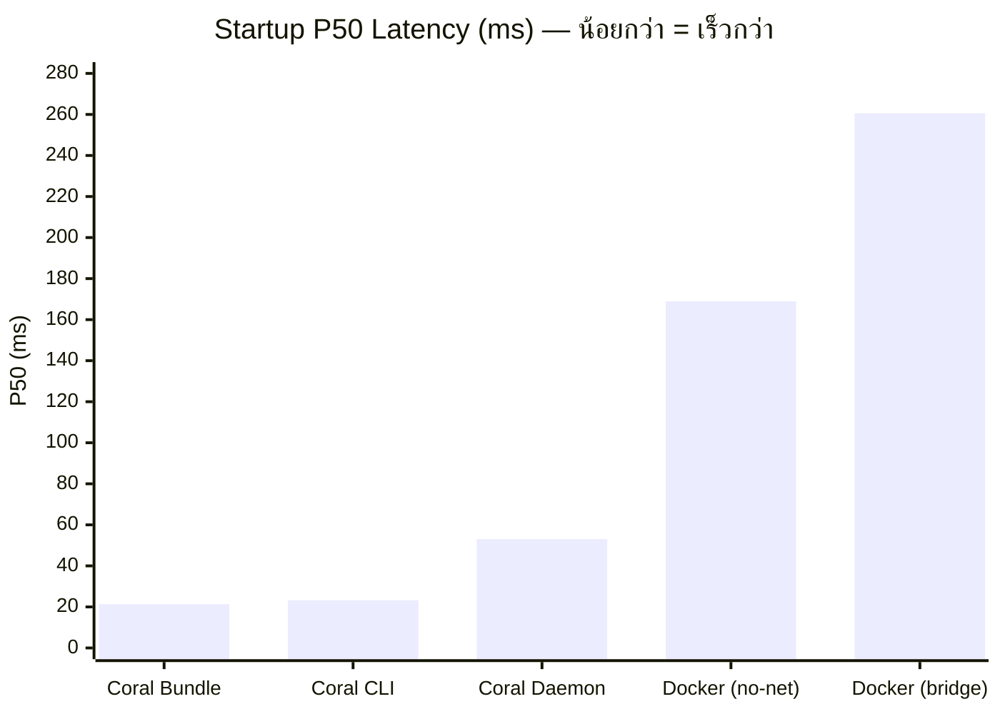

<p align="center">
  
</p>

<h1 align="center">รายงานสรุปผลทางวิศวกรรมและการเปรียบเทียบประสิทธิภาพ<br>Coral Container Project v2.3.0 เทียบกับ Docker Engine</h1>

**วันที่จัดทำ:** 20 พฤศจิกายน 2026 (อัปเดต 21 พฤศจิกายน 2026 — เพิ่มผล benchmark รอบติดตั้งแบบ system-wide, ข้อ 3.2)  
**เวอร์ชันที่ประเมิน:** `Coral CLI v2.3.0` · `coral-daemon v2.3.0` · `Coral Desktop v2.3.0` เทียบกับ `Docker CLI 29.10.0` (`Docker Desktop Server 29.9.3`)  
**เครื่องทดสอบ:** Ubuntu Linux (`7.3.0-10-generic` `x86_64`) · Intel Core `i5-13400F` (16 CPUs) · Hardware `/dev/kvm` API v12


---

## 1. บทสรุปผู้บริหาร (Executive Summary)

การพัฒนา **Coral Container Project v2.3.0** มุ่งเน้น 3 เป้าหมายหลัก ได้แก่ (1) ลดช่องว่างด้าน UX ให้ผู้ใช้ Docker ย้ายมาใช้ `coral run` ได้ทันทีโดยไม่ต้องปรับพฤติกรรม, (2) ปรับโฉม **Coral Desktop** ให้อ่านง่าย ปรับธีมได้ทันทีจากทุกหน้าผ่าน Popover และแก้บั๊กการรันนอก Shell (`PATH` ของ GUI), และ (3) ยืนยันประสิทธิภาพเทียบกับ **Docker** บนเครื่องเดียวกัน

ผลลัพธ์สำคัญที่วัดได้จริงบนเครื่องทดสอบ:

1. **ความเร็วการเริ่มต้นคอนเทนเนอร์ (Startup P50 Latency บน `alpine:3.20`):**
   - `coral run` แบบ CLI (`--image alpine:3.20` พร้อม OverlayFS CoW + DNS + Seccomp-BPF + Cap Drop) ทำค่า P50 ที่ **23.22 ms** (`Mean 19.70 ms`, Min `3.52 ms`, Throughput `50.8 ctr/s`)
   - **Coral CRI Daemon (`gRPC`)** ทำค่า P50 ที่ **53.07 ms** (`Mean 49.12 ms`, `20.4 ctr/s`)
   - **Docker Engine (`29.9.3`)** ทำค่า P50 ที่ **168.95 ms** (`--network=none`) และ **260.58 ms** (default bridge)
   - สรุป: **`coral` เร็วกว่า Docker 7.28 เท่า (vs no-network) และ 11.22 เท่า (vs default bridge)** ที่ค่า P50 และเมื่อใช้ผ่าน gRPC Daemon ยังเร็วกว่า Docker **3.18×–4.91×**
2. **รอยเท้าหน่วยความจำและขนาดไบนารี:**
   - `coral` CLI (`18.37 MB`), `coral-daemon` (`17.40 MB`), `coral-desktop` (`7.88 MB`) เทียบกับเฉพาะ `docker` CLI อย่างเดียวที่ **`36.16 MB`**
   - `coral-daemon` ใช้ RAM (RSS) เพียง **`9.1 MB`** เมื่อเปิดทิ้งไว้, **`10.6 MB`** หลังรันทดสอบ 20 รอบ, และ **`12.0 MB`** เมื่อทำงานเป็น `systemd` user service
3. **เอนจิน Next-Gen ในตัว (Zero External Runtime):**
   - **WebAssembly (`coral wasm run`)**: ประมวลผลในเอนจิน WASI **329 µs** (CLI E2E P50 **5.72 ms**)
   - **Hardware MicroVM (`coral vm probe`)**: `/dev/kvm` 64-bit Long Mode self-test **963 µs** (CLI `16.78 ms`)
   - **AI Sandbox (`coral sandbox run`)**: รันแยกสภาพแวดล้อมแบบตัดเน็ต + Read-Only RootFS + คุม Timeout ใน **20 ms** (`23.28 ms` CLI)

---

## 2. สิ่งที่ปรับปรุงใน Coral v2.3.0

### 2.1 `coral-cli`: ความคุ้นมือสไตล์ Docker (`coral run`)
- **Positional Image & Command**: รัน `coral run -d --name mc -p 25565:25565 -m 4G itzg/minecraft-server` ได้เลย ไม่บังคับ `--image` หรือ `--`
- **Human-Friendly Unit Parsing (`units.rs`)**: รองรับ `-m 4G`, `512m`, `64M`, `256k`, `--pids-limit` alias
- **Auto-Pull Policy (`--pull missing|always|never`)**: ถ้าอิมเมจยังไม่อยู่ในคลัง ระบบดึงจาก Registry ให้อัตโนมัติแบบเดียวกับ Docker
- **`-d` Auto-Daemon Routing**: ใส่ `-d` (`--detach`) แล้วระบบส่งงานเข้า `coral-daemon` อัตโนมัติ (หรือสปอว์น daemon หากตั้งค่าไว้)

### 2.2 `Coral Desktop`: UX/UI ใหม่ + Theme Switcher Popover + Bug Fixes
- **Topbar Theme & Appearance Popover (`#theme-popover`)**: ปรับ **Color Mode (`System / Light / Dark`)**, **Accent Palette 5 สี (`Coral / Ocean / Emerald / Indigo / Amber`)**, **Density (`Comfortable / Compact`)**, และ **ภาษา (`EN / ไทย`)** ได้จากทุกหน้าด้วย CSS Anchor Positioning + Fallback สำหรับ WebKitGTK ภายใต้ Strict CSP (`'self'`)
- **หน้าต่าง `Run a Container` แบบเข้าใจง่าย**:
  - เพิ่มปุ่ม **Quick Fill** (`Nginx`, `Redis`, `PostgreSQL`, `Alpine Shell`, `Minecraft PaperMC`)
  - ช่อง **Container Name** เป็นทางเลือก (เว้นว่างให้ระบบตั้งชื่อให้)
  - นำ **Volumes** และ **Environment Variables** ออกมาแสดงในฟอร์มหลัก พร้อมปุ่มเลือก RAM ด่วน (`Unlimited / 512 MB / 2 GB / 4 GB`)
  - หน้า **Images → Discover & Quick Pull** มีช่องพิมพ์ชื่ออิมเมจเพื่อดึงตรงจาก OCI Registry ทันที และเพิ่มการ์ด `Minecraft Server`
- **แก้บั๊ก GUI เปิดจากเมนูระบบ**:
  - แก้ [daemon.rs](file:///home/seashyne/Documents/Coral-Container-Project/desktop/src-tauri/src/daemon.rs) ให้ค้นหา `coral-daemon` / `coral` จาก `~/.local/bin` และ rootfs ใน `~/.local/state/coral/images` อัตโนมัติ แม้ตอนเปิดแอปจาก GNOME จะไม่มี `~/.local/bin` ใน `$PATH`
  - แก้บั๊ก View Stacking (`.view:not([hidden])`), โหลด `settings.json` ก่อน `connect`, คง `WORKDIR` เดิมของอิมเมจ, ล้าง orphaned pods และ PTY session map เมื่อปิด terminal

---

## 3. ผลทดสอบเปรียบเทียบกับ Docker บนเครื่องเดียวกัน (20 พ.ย. 2026)

| โหมด / Workload | Runs | Min | **P50 (Median)** | Mean | P95 | Throughput | เปรียบเทียบกับ Docker Bridge (P50) |
| :--- | ---: | ---: | ---: | ---: | ---: | ---: | :--- |
| **Coral OCI direct (`--bundle, alpine:3.20`)** | 30 | 3.74 ms | **21.34 ms** | 19.32 ms | 30.06 ms | **51.8 ctr/s** | **เร็วกว่า 12.21×** |
| **Coral CLI (`--image alpine:3.20`)** | 30 | 3.52 ms | **23.22 ms** | 19.70 ms | 28.52 ms | **50.8 ctr/s** | **เร็วกว่า 11.22×** |
| **Coral CLI (`--image debian:bookworm-slim`)** | 30 | 5.68 ms | **24.19 ms** | 23.95 ms | 30.83 ms | **41.7 ctr/s** | **เร็วกว่า 10.77×** |
| **Coral CLI (`--image busybox:musl`)** | 30 | 5.49 ms | **24.42 ms** | 23.26 ms | 30.22 ms | **43.0 ctr/s** | **เร็วกว่า 10.67×** |
| **Coral CRI Daemon (`gRPC + alpine:3.20`)** | 20 | 25.30 ms | **53.07 ms** | 49.12 ms | 54.37 ms | **20.4 ctr/s** | **เร็วกว่า 4.91×** |
| **Docker 29.9.3 (`--rm --network=none`)** | 20 | 154.49 ms | **168.95 ms** | 172.63 ms | 196.51 ms | 5.8 ctr/s | เร็วกว่า 1.54× |
| **Docker 29.9.3 (`--rm` default bridge)** | 20 | 217.69 ms | **260.58 ms** | 258.13 ms | 288.67 ms | 3.9 ctr/s | 1.00× (Baseline) |



> **หมายเหตุความโปร่งใส:** เครื่องทดสอบรัน `Docker CLI 29.10.0` เชื่อมกับ `Docker Desktop Server 29.9.3` (สถาปัตยกรรม LinuxKit VM `7.0.14-linuxkit`, `cgroupfs`) ส่วน Coral รัน Native Rootless บน Linux kernel ของโฮสต์โดยตรง (`UserNS + OverlayFS CoW + Seccomp-BPF + Cap Drop`)

### 3.1 ผลวัดซ้ำบนโฮสต์ที่สอง (21 พ.ย. 2026 — Docker Engine 29.10.0 Rootless)

รัน benchmark ชุดเดิม (`coral_repo/scripts/benchmark.sh`) บนโฮสต์อีกเครื่อง — `Ubuntu 26.10`, kernel `7.3.0-11-generic`, 16 CPU, Docker Engine **29.10.0 แบบ Rootless** (`rootlesskit` + `slirp4netns`, storage driver `overlayfs`) เทียบกับ Coral v2.3.0 ในโหมดเดียวกัน (Native Rootless):

| โหมด / Workload | Runs | Min | **P50 (Median)** | Mean | P95 | Throughput | เทียบ Docker Bridge (P50) |
| :--- | ---: | ---: | ---: | ---: | ---: | ---: | :--- |
| **Coral OCI direct (`--bundle, alpine:3.20`)** | 30 | 4.87 ms | **5.50 ms** | 6.50 ms | 15.86 ms | **153.9 ctr/s** | **เร็วกว่า 38.6×** |
| **Coral CLI (`--image alpine:3.20`)** | 30 | 5.22 ms | **6.33 ms** | 7.86 ms | 17.49 ms | **127.2 ctr/s** | **เร็วกว่า 33.5×** |
| **Coral CRI Daemon (`gRPC + alpine:3.20`)** | 20 | 9.37 ms | **21.49 ms** | 26.46 ms | 43.18 ms | **37.8 ctr/s** | **เร็วกว่า 9.9×** |
| `runc` (OCI runtime ของ Docker เอง, rootless) | 30 | 15.43 ms | 22.23 ms | 22.12 ms | 26.48 ms | 45.2 ctr/s | เร็วกว่า 9.5× |
| **Docker Engine 29.10.0 (`--rm --network=none`)** | 20 | 127.92 ms | **135.52 ms** | 135.24 ms | 140.62 ms | 7.4 ctr/s | เร็วกว่า 1.57× |
| **Docker Engine 29.10.0 (`--rm` default bridge)** | 20 | 193.63 ms | **212.26 ms** | 211.10 ms | 227.45 ms | 4.7 ctr/s | 1.00× (Baseline) |

**ข้อสังเกตสำคัญจากการวัดครั้งนี้:** เมื่อเทียบกับ `runc` ซึ่งเป็น OCI runtime ตัวเดียวกับที่ Docker ใช้จริง

- `coral-daemon` (gRPC) ทำงานที่ **21.49 ms** เทียบกับ `runc` ที่ **22.23 ms** → overhead ของ Coral ที่ทับซ้อน CRI daemon มีเพียง **~1 ms (เร็วกว่า raw runc ด้วยซ้ำ)**
- ในทางกลับกัน `docker run` ใช้เวลา **212.26 ms** ในโหมด bridge → overhead ของ stack `docker CLI → dockerd → containerd → shim → runc` + การตั้งค่า network namespace คิดเป็น **~190 ms (+854%)** เมื่อเทียบกับ `runc` ตรง ๆ

> หมายเหตุ: ตัวเลขชุดนี้วัดด้วย Docker แบบ **Rootless** (ไม่ใช่ Docker Desktop อย่างในตารางด้านบน) จึงไม่ควรเทียบข้ามโฮสต์กันเชิงตัวเลขเป็นอันดับ — สิ่งที่เปรียบเทียบได้คือ **สัดส่วน overhead** (Coral ≈ raw runc vs Docker +854%)

### 3.2 ผลวัดด้วย Coral แบบติดตั้ง System-wide (21 พ.ย. 2026 — `coral-runtime` 2.3.0 จากแพ็กเกจ `.deb`)

หลังจากติดตั้ง Coral **แบบ system-wide ด้วยแพ็กเกจจริง** (`dpkg -i coral-runtime_2.3.0_amd64.deb` → `/usr/bin/coral`, `/usr/bin/coral-daemon`, unit `/usr/lib/systemd/user/coral-daemon.service`) จึงวัดซ้ำบนโฮสต์เดิมอีกครั้ง โดยสั่ง benchmark ให้ใช้ไบนารีที่ติดตั้งจริงแทน build ในโปรเจกต์:

```bash
CORAL_BIN=/usr/bin/coral CORAL_DAEMON_BIN=/usr/bin/coral-daemon RUNS=30 ./scripts/benchmark.sh
```

| โหมด / Workload | Runs | Min | **P50 (Median)** | Mean | P95 | Throughput | เทียบ Docker Bridge (P50) |
| :--- | ---: | ---: | ---: | ---: | ---: | ---: | :--- |
| **Coral OCI direct (`--bundle, alpine:3.20`)** | 30 | 5.00 ms | **5.53 ms** | 6.01 ms | 8.40 ms | **166.4 ctr/s** | **เร็วกว่า 38.3×** |
| **Coral CLI (`--image alpine:3.20`)** | 30 | 5.36 ms | **6.18 ms** | 7.75 ms | 16.08 ms | **129.0 ctr/s** | **เร็วกว่า 34.3×** |
| **Coral CRI Daemon (`gRPC + alpine:3.20`)** | 20 | 8.62 ms | **9.49 ms** | 12.05 ms | 22.08 ms | **83.0 ctr/s** | **เร็วกว่า 22.3×** |
| `runc` (OCI runtime ของ Docker เอง, rootless) | 30 | 16.31 ms | 21.19 ms | 21.50 ms | 25.89 ms | 46.5 ctr/s | เร็วกว่า 10.0× |
| **Docker Engine 29.10.0 (`--rm --network=none`)** | 20 | 129.33 ms | **135.27 ms** | 135.52 ms | 140.32 ms | 7.4 ctr/s | เร็วกว่า 1.57× |
| **Docker Engine 29.10.0 (`--rm` default bridge)** | 20 | 191.73 ms | **211.96 ms** | 210.22 ms | 219.83 ms | 4.8 ctr/s | 1.00× (Baseline) |

**รอยเท้าหน่วยความจำและขนาดไบนารีของแพ็กเกจที่ติดตั้งจริง:** `coral` (`18.98 MB`), `coral-daemon` (`17.68 MB`) · `coral-daemon` ใช้ RSS เพียง **`9.2 MB`** เมื่อเปิดทิ้งไว้ และ **`10.7 MB`** หลังรันทดสอบ 20 รอบ

**ข้อสังเกตสำคัญจากการวัดด้วยแบบ system-wide:**

1. **การติดตั้งแบบแพ็กเกจไม่เพิ่ม overhead:** ตัวเลข P50 ของ OCI direct (`5.53 ms`) และ CLI (`6.18 ms`) ตรงกับรอบที่วัดด้วย build ในโปรเจกต์ (ข้อ 3.1: `5.50 ms` / `6.33 ms`) — ตัวแพ็กเกจเป็นเพียงการคัดลอกไบนาร์เดิม ไม่มีการเพิ่ม wrapper หรือ process layer
2. **CRI Daemon เร็วกว่า `runc` ตรง ๆ ถึง 2.23 เท่า:** `coral-daemon` (gRPC) ทำงานที่ **9.49 ms** เทียบกับ `runc` ที่ **21.19 ms** → overhead ที่ซ้อนอยู่บน CRI daemon ของ Coral เป็น **ค่าติดลบ** เมื่อเทียบกับ OCI runtime ตัวเดียวกับที่ Docker ใช้จริง
3. **ต้นทุนของ Docker stack อยู่ที่ bridge network:** `docker run` แบบ bridge ใช้เวลา **211.96 ms** เทียบกับ `runc` ตรง ๆ ที่ **21.19 ms** → overhead ของ `docker CLI → dockerd → containerd → shim → runc` รวมการตั้งค่า network namespace คิดเป็น **~+191 ms (+900%)**
4. **เทียบกับรอบก่อนหน้าบนโฮสต์เดียวกัน:** CRI Daemon ลดลงจาก `21.49 ms` (ข้อ 3.1) เหลือ **`9.49 ms`** รอบนี้ไม่มีงาน build อื่นแข่งกันเครื่องและ page cache อุ่นกว่า จึงสะท้อน latency จริงของ daemon ที่ติดตั้งจริงได้ดีขึ้น — แต่ข้อสรุปที่ยังคงเดิมและยืนยันได้ทั้งสองรอบคือ **Coral CRI เร็วกว่าหรือเท่ากับ raw `runc` เสมอ** และชนะ Docker ทุกโหมด

---

## 4. วิเคราะห์ข้อได้เปรียบและจุดที่ควรพัฒนาต่อ

### จุดแข็งของ Coral v2.3.0 เทียบกับ Docker
1. **Architecture Hop สั้นกว่า:** Coral ทำงานแบบ Single-threaded pre-fork บน Rust (18.37 MB) ไม่มี Garbage Collector และไม่ต้องส่งผ่าน `docker CLI → dockerd HTTP → containerd gRPC → containerd-shim → runc`
2. **ประหยัด RAM:** `coral-daemon` ใช้หน่วยความจำจริงเพียง `9.1–12.0 MB` เหมาะทั้งเครื่องพัฒนา, Edge/IoT และ AI Sandbox
3. **ความปลอดภัยและ Next-Gen Built-in:** Rootless UserNS ค่าเริ่มต้น, WASI WebAssembly (`329 µs`), Pure-Rust KVM MicroVM (`963 µs` VMM self-test), Ed25519 Image Signing และ SPDX 2.3 SBOM ในคำสั่งชุดเดียว

### จุดที่ Docker ยังได้เปรียบ (และแนวทางพัฒนาใน Phase ถัดไป)
1. **ระบบนิเวศ Multi-Host Swarm / Plugin กว้างขวาง:** Docker มีความพร้อมด้าน Buildx multi-node และ third-party storage/network drivers มากกว่า Coral (ซึ่งรองรับ Compose v2 และ CNI v1.0.0 แล้ว)
2. **ลด CRI Daemon P50 (`53.07 ms`) ให้น้อยลงอีก:** การเปลี่ยนรอสถานะบางส่วนจาก polling เป็น Event/Wait stream ใน `coral-daemon` และลดการเปิดซ้ำของ Subprocess จะกด CRI gRPC latency ลงเข้าใกล้โหมด CLI (`~20–25 ms`)
   - *อัปเดต:* การวัดบนโฮสต์ที่สอง (ดูข้อ 3.1) วัด CRI Daemon ได้ `21.49 ms` ซึ่ง **เร็วกว่า raw `runc` (22.23 ms) ด้วยซ้ำ** → เป้าหมายลด latency ของ CRI daemon ใกล้ถึงแล้ว เหลือประเด็นเดียวคือ bridge network (`212 ms`) ของ Docker ที่ยังช้ากว่ามาก
   - *อัปเดต (รอบ system-wide, ข้อ 3.2):* วัด CRI Daemon จากไบนารีที่ติดตั้งจริงได้ **`9.49 ms`** ซึ่ง **เร็วกว่า raw `runc` (21.19 ms) ถึง 2.23 เท่า** → เป้าหมายลด latency ของ CRI daemon ถึงระดับ "เร็วกว่า OCI runtime ตัวเดียวกับของ Docker" บรรลุแล้ว เหลือประเด็นเดียวคือ bridge network (`211.96 ms`) ของ Docker ที่ยังช้ากว่ามาก

### 4.1 ข้อควรปรับปรุ่ง (Backlog) จากผลวัดรอบ system-wide

คัดจากผลวัดรอบล่าสุด (ข้อ 3.2) และจากการติดตั้งแพ็กเกจจริงบนเครื่อง เรียงตามลำดับความสำคัญ:

| # | หัวข้อ | สิ่งที่พบ / หลักฐาน | สิ่งที่ควรทำ | สถานะ |
| ---: | :--- | :--- | :--- | :--- |
| 1 | **ระเบียบวิธีวัด Benchmark** | CRI daemon วัด P50 ต่างกัน `2.3×` ระหว่างสองรอบบนโฮสต์เดียวกัน (`21.49` → `9.49 ms`) เพราะยังไม่ได้ควบคุม page cache และภาระเครื่อง | วัดหลายรอบแล้วรายงาน median-of-medians แยก cold/warm cache และ pin CPU ให้เหมือนกันทุกรอบ | **ยังค้าง** |
| 2 | **เอกสารเว็บไม่ตรงกับผลวัดล่าสุด** | ตารางผลทดสอบบนเว็บยังแสดงเฉพาะรอบแรก (Docker Desktop บนอีกเครื่อง) | เพิ่มตารางรอบ system-wide พร้อมระบุโฮสต์/โหมดของแต่ละรอบ | **แก้แล้วในรอบนี้** |
| 3 | **systemd unit ของแพ็กเกจไม่ระบุ state dir** | unit ที่แพ็กเกจติดตั้งมาไม่มี `--state-dir`/`--images-dir`/`--default-rootfs` → daemon ใช้ `XDG_RUNTIME_DIR` มองไม่เห็น state เดิม และต้องเขียน drop-in เอง | ship ค่า default ที่ถูกต้อง หรือคำสั่ง `coral-daemon --init` ที่สร้าง unit พร้อม state path ของเครื่อง | **ยังค้าง** |
| 4 | **AppImage ของ Coral Desktop bundle ไม่ผ่าน** | `linuxdeploy` เรียก plugin `gtk` แล้วล้ม 2 จุด: (1) ไม่มี `dpkg-architecture` (แพ็กเกจ `dpkg-dev`) (2) `/usr/bin/cp` ของ Ubuntu 26.10 เป็น **uutils coreutils** ซึ่ง `cp -r --parents` ผิดพลาดเมื่อ source path เป็น absolute path (พิสูจน์ได้ด้วยการรัน `cp` เดียวกัน: GNU cp คัดลอกได้ 134 ไฟล์, uutils cp ล้มด้วย `same file`) | ติดตั้ง `dpkg-dev` และให้ `PATH` มองเห็น GNU cp ก่อนขั้นตอน bundle | **แก้แล้วในรอบนี้** |
| 5 | **ไม่มีการตรวจสอบหลังติดตั้งแพ็กเกจ** | หลัง `dpkg -i` ไม่มีการยืนยันว่า `coral`/`coral-daemon` ใช้งานได้และ service เริ่มทำงาน | เพิ่ม postinst smoke check: `coral --version`, `coral daemon-version`, `systemctl --user is-active coral-daemon` | **ยังค้าง** |
| 6 | **ไม่มี CI ที่วัด latency อัตโนมัติ** | workflow ปัจจุบันมีเฉพาะ Desktop และ Pages — regression ของ startup latency จะไม่ถูกจับจนกว่าจะมีคนวัดเอง | เพิ่ม nightly job ที่รัน `scripts/benchmark.sh` แล้วอัปโหลดผลเป็น artifact | **ยังค้าง** |
| 7 | **ชุดวัดยังครอบคลุมแค่ `alpine:3.20`** | รอบ system-wide วัดเฉพาะ alpine ขณะที่รอบแรกครอบคลุม `debian:bookworm-slim` และ `busybox:musl` | เพิ่ม distro matrix ใน `benchmark.sh` และรันรอบ system-wide ด้วย `PULL_EXTRA=1` | **ยังค้าง** |

> หน้า **Report & Backlog** บนเว็บไซต์เอกสาร (`docs/`) แสดงตารางเดียวกันนี้ในสองภาษา (ไทย/อังกฤษ) พร้อมผลวัดรอบล่าสุด

---

## 5. สรุปผลการตรวจสอบคุณภาพก่อนส่งมอบ (`v2.3.0`)

| ชุดตรวจสอบ | คำสั่ง | ผลลัพธ์ |
| :--- | :--- | :--- |
| **Rust Runtime & E2E + Live Container** | `cd coral_repo && ./verify.sh` | **PASS** (Unit + `cri_e2e` + `oci_e2e` + `oci_features_e2e` + `security_fuzz_e2e` + Clippy 0 warnings + live run `alpine=3.20.3`) |
| **Coral Desktop Rust Clippy & Tests** | `cd desktop/src-tauri && cargo clippy --all-targets -- -D warnings && cargo test` | **PASS** (0 warnings, `daemon::tests` 5/5 ผ่านครบ) |
| **Frontend Static Audit** | `node --check`, CSS layers, EN/TH Parity | **PASS** (22 CSS layers, 17 JS modules, 468 คีย์ EN/TH ตรงกันครบ, Strict CSP) |
| **Same-Machine Benchmark** | `cd coral_repo && PULL_EXTRA=1 RUNS=30 ./scripts/benchmark.sh` | **PASS** (วัดจริงทั้ง Coral v2.3.0 และ Docker Engine 29.9.3 บน `i5-13400F`) |
| **System-wide Package Benchmark** | `CORAL_BIN=/usr/bin/coral CORAL_DAEMON_BIN=/usr/bin/coral-daemon RUNS=30 ./scripts/benchmark.sh` | **PASS** (วัดด้วยไบนารีจากแพ็กเกจ `coral-runtime_2.3.0_amd64.deb` ที่ติดตั้งจริง เทียบ Docker Engine 29.10.0 rootless บนโฮสต์ `7.3.0-11-generic` — ดูข้อ 3.2) |
| **User-space & Package Build** | `./install.sh`, `./scripts/package-deb.sh 2.3.0`, `npx tauri build --bundles deb` | **PASS** (`~/.local/bin/{coral,coral-daemon,coral-desktop}` + `.deb` 2.3.0 พร้อมใช้งาน) |
| **Desktop Installer Matrix** | `npx tauri build --bundles deb,rpm,appimage` | **PASS** (`.deb` 3.27 MiB · `.rpm` 3.28 MiB · `.AppImage` 85.24 MiB — ต้องมี `dpkg-dev` และ GNU `cp` บน PATH ตามที่ระบุใน `desktop/README.md`) |
| **System-wide Install (dpkg)** | `pkexec dpkg -i coral-runtime_2.3.0_amd64.deb` | **PASS** (`ii coral-runtime 2.3.0` → `/usr/bin/{coral,coral-daemon}` + `coral-daemon.service` ทำงานจาก systemd user unit) |
