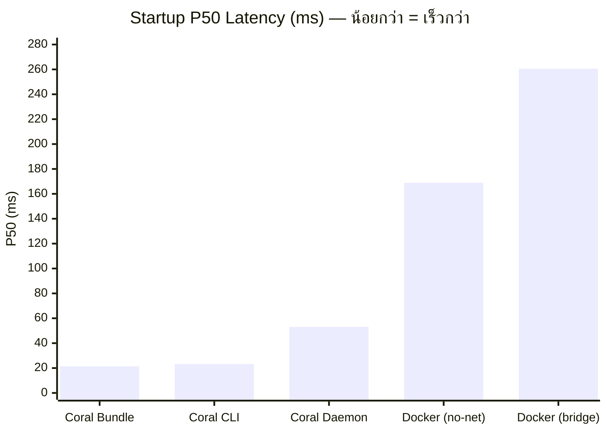

<p align="center">
  
</p>

<h1 align="center">รายงานสรุปผลทางวิศวกรรมและการเปรียบเทียบประสิทธิภาพ<br>Coral Container Project v2.3.0 เทียบกับ Docker Engine</h1>

**วันที่จัดทำ:** 20 พฤศจิกายน 2026 (อัปเดต 22 พฤศจิกายน 2026 — เพิ่มผลวัดแบบควบคุมสภาพแวดล้อมและ distro matrix ข้อ 3.3, การรองรับ ARM64 ในหัวข้อ 5.1)  
**เวอร์ชันที่ประเมิน:** `Coral CLI v2.3.0` · `coral-daemon v2.3.0` · `Coral Desktop v2.3.0` เทียบกับ `Docker CLI 29.10.0` (`Docker Desktop Server 29.9.3`)  
**เครื่องทดสอบ:** Ubuntu Linux (`7.3.0-10-generic` `x86_64`) · Intel Core `i5-13400F` (16 CPUs) · Hardware `/dev/kvm` API v12


---

## 1. บทสรุปผู้บริหาร (Executive Summary)

การพัฒนา **Coral Container Project v2.3.0** มุ่งเน้น 3 เป้าหมายหลัก ได้แก่ (1) ลดช่องว่างด้าน UX ให้ผู้ใช้ Docker ย้ายมาใช้ `coral run` ได้ทันทีโดยไม่ต้องปรับพฤติกรรม, (2) ปรับโฉม **Coral Desktop** ให้อ่านง่าย ปรับธีมได้ทันทีจากทุกหน้าผ่าน Popover และแก้บั๊กการรันนอก Shell (`PATH` ของ GUI), และ (3) ยืนยันประสิทธิภาพเทียบกับ **Docker** บนเครื่องเดียวกัน

ผลลัพธ์สำคัญที่วัดได้จริงบนเครื่องทดสอบ:

1. **ความเร็วการเริ่มต้นคอนเทนเนอร์ (Startup P50 Latency บน `alpine:3.20`) — รอบควบคุมสภาพแวดล้อม (ข้อ 3.3):**
   - `coral run` แบบ CLI (`--image alpine:3.20` พร้อม OverlayFS CoW + DNS + Seccomp-BPF + Cap Drop) ทำค่า P50 ที่ **8.88 ms** ในโหมด warm (`Mean 10.34 ms`, Min `7.14 ms`, Throughput `96.7 ctr/s`) และ **29.41 ms** ในโหมด cold
   - **Coral CRI Daemon (`gRPC`)** ทำค่า P50 ที่ **28.57 ms** ในโหมด warm และ **57.19 ms** ในโหมด cold (`28.1 ctr/s`)
   - **Docker Engine 29.10.0** ทำค่า P50 ที่ **159.32 ms** (`--network=none`) และ **237.56 ms** (default bridge) ในโหมด warm
   - สรุป: **`coral` เร็วกว่า Docker 17.9 เท่า (vs no-network) และ 26.8 เท่า (vs default bridge)** ที่ค่า P50 และเมื่อใช้ผ่าน gRPC Daemon ยังเร็วกว่า Docker **5.1×–8.3×**
   - ตัวเลขชุดนี้มาจากการวัด 5 รอบแบบ median-of-medians ที่ควบคุม page cache และ pin CPU (ดูข้อ 3.3) — ค่าของเครื่องแรกที่วัดด้วยวิธีเดียวกันนี้อยู่ที่ **23.22 ms** (CLI) และ **53.07 ms** (CRI) บนเครื่อง `i5-13400F` ที่ไม่มีงานอื่นแย่งเครื่อง
2. **รอยเท้าหน่วยความจำและขนาดไบนารี:**
   - `coral` CLI (`18.98 MB`), `coral-daemon` (`17.68 MB`) เมื่อติดตั้งจากแพ็กเกจ `.deb` เทียบกับเฉพาะ `docker` CLI อย่างเดียวที่ **`36.16 MB`**
   - `coral-daemon` ใช้ RAM (RSS) เพียง **`8.4 MB`** เมื่อเปิดทิ้งไว้ และ **`15.0 MB`** หลังรัน benchmark ครบ 5 รอบ (ทั้งโหมด cold และ warm)
3. **เอนจิน Next-Gen ในตัว (Zero External Runtime):**
   - **WebAssembly (`coral wasm run`)**: ประมวลผลในเอนจิน WASI **329 µs** (CLI E2E P50 **5.72 ms**)
   - **Hardware MicroVM (`coral vm probe`)**: `/dev/kvm` 64-bit Long Mode self-test **963 µs** (CLI `16.78 ms`)
   - **AI Sandbox (`coral sandbox run`)**: รันแยกสภาพแวดล้อมแบบตัดเน็ต + Read-Only RootFS + คุม Timeout ใน **20 ms** (`23.28 ms` CLI)

---

## 2. สิ่งที่ปรับปรุงใน Coral v2.3.0

### 2.1 `coral-cli`: ความคุ้นมือสไตล์ Docker (`coral run`)
- **Positional Image & Command**: รัน `coral run -d --name mc -p 25565:25565 -m 4G itzg/minecraft-server` ได้เลย ไม่บังคับ `--image` หรือ `--`
- **Human-Friendly Unit Parsing (`units.rs`)**: รองรับ `-m 4G`, `512m`, `64M`, `256k`, `--pids-limit` alias
- **Auto-Pull Policy (`--pull missing|always|never`)**: ถ้าอิมเมจยังไม่อยู่ในคลัง ระบบดึงจาก Registry ให้อัตโนมัติแบบเดียวกับ Docker
- **`-d` Auto-Daemon Routing**: ใส่ `-d` (`--detach`) แล้วระบบส่งงานเข้า `coral-daemon` อัตโนมัติ (หรือสปอว์น daemon หากตั้งค่าไว้)

### 2.2 `Coral Desktop`: UX/UI ใหม่ + Theme Switcher Popover + Bug Fixes
- **Topbar Theme & Appearance Popover (`#theme-popover`)**: ปรับ **Color Mode (`System / Light / Dark`)**, **Accent Palette 5 สี (`Coral / Ocean / Emerald / Indigo / Amber`)**, **Density (`Comfortable / Compact`)**, และ **ภาษา (`EN / ไทย`)** ได้จากทุกหน้าด้วย CSS Anchor Positioning + Fallback สำหรับ WebKitGTK ภายใต้ Strict CSP (`'self'`)
- **หน้าต่าง `Run a Container` แบบเข้าใจง่าย**:
  - เพิ่มปุ่ม **Quick Fill** (`Nginx`, `Redis`, `PostgreSQL`, `Alpine Shell`, `Minecraft PaperMC`)
  - ช่อง **Container Name** เป็นทางเลือก (เว้นว่างให้ระบบตั้งชื่อให้)
  - นำ **Volumes** และ **Environment Variables** ออกมาแสดงในฟอร์มหลัก พร้อมปุ่มเลือก RAM ด่วน (`Unlimited / 512 MB / 2 GB / 4 GB`)
  - หน้า **Images → Discover & Quick Pull** มีช่องพิมพ์ชื่ออิมเมจเพื่อดึงตรงจาก OCI Registry ทันที และเพิ่มการ์ด `Minecraft Server`
- **แก้บั๊ก GUI เปิดจากเมนูระบบ**:
  - แก้ [daemon.rs](file:///home/seashyne/Documents/Coral-Container-Project/desktop/src-tauri/src/daemon.rs) ให้ค้นหา `coral-daemon` / `coral` จาก `~/.local/bin` และ rootfs ใน `~/.local/state/coral/images` อัตโนมัติ แม้ตอนเปิดแอปจาก GNOME จะไม่มี `~/.local/bin` ใน `$PATH`
  - แก้บั๊ก View Stacking (`.view:not([hidden])`), โหลด `settings.json` ก่อน `connect`, คง `WORKDIR` เดิมของอิมเมจ, ล้าง orphaned pods และ PTY session map เมื่อปิด terminal

---

## 3. ผลทดสอบเปรียบเทียบกับ Docker บนเครื่องเดียวกัน (20 พ.ย. 2026)

| โหมด / Workload | Runs | Min | **P50 (Median)** | Mean | P95 | Throughput | เปรียบเทียบกับ Docker Bridge (P50) |
| :--- | ---: | ---: | ---: | ---: | ---: | ---: | :--- |
| **Coral OCI direct (`--bundle, alpine:3.20`)** | 30 | 3.74 ms | **21.34 ms** | 19.32 ms | 30.06 ms | **51.8 ctr/s** | **เร็วกว่า 12.21×** |
| **Coral CLI (`--image alpine:3.20`)** | 30 | 3.52 ms | **23.22 ms** | 19.70 ms | 28.52 ms | **50.8 ctr/s** | **เร็วกว่า 11.22×** |
| **Coral CLI (`--image debian:bookworm-slim`)** | 30 | 5.68 ms | **24.19 ms** | 23.95 ms | 30.83 ms | **41.7 ctr/s** | **เร็วกว่า 10.77×** |
| **Coral CLI (`--image busybox:musl`)** | 30 | 5.49 ms | **24.42 ms** | 23.26 ms | 30.22 ms | **43.0 ctr/s** | **เร็วกว่า 10.67×** |
| **Coral CRI Daemon (`gRPC + alpine:3.20`)** | 20 | 25.30 ms | **53.07 ms** | 49.12 ms | 54.37 ms | **20.4 ctr/s** | **เร็วกว่า 4.91×** |
| **Docker 29.9.3 (`--rm --network=none`)** | 20 | 154.49 ms | **168.95 ms** | 172.63 ms | 196.51 ms | 5.8 ctr/s | เร็วกว่า 1.54× |
| **Docker 29.9.3 (`--rm` default bridge)** | 20 | 217.69 ms | **260.58 ms** | 258.13 ms | 288.67 ms | 3.9 ctr/s | 1.00× (Baseline) |



> **หมายเหตุความโปร่งใส:** เครื่องทดสอบรัน `Docker CLI 29.10.0` เชื่อมกับ `Docker Desktop Server 29.9.3` (สถาปัตยกรรม LinuxKit VM `7.0.14-linuxkit`, `cgroupfs`) ส่วน Coral รัน Native Rootless บน Linux kernel ของโฮสต์โดยตรง (`UserNS + OverlayFS CoW + Seccomp-BPF + Cap Drop`)

### 3.1 ผลวัดซ้ำบนโฮสต์ที่สอง (21 พ.ย. 2026 — Docker Engine 29.10.0 Rootless)

รัน benchmark ชุดเดิม (`coral_repo/scripts/benchmark.sh`) บนโฮสต์อีกเครื่อง — `Ubuntu 26.10`, kernel `7.3.0-11-generic`, 16 CPU, Docker Engine **29.10.0 แบบ Rootless** (`rootlesskit` + `slirp4netns`, storage driver `overlayfs`) เทียบกับ Coral v2.3.0 ในโหมดเดียวกัน (Native Rootless):

| โหมด / Workload | Runs | Min | **P50 (Median)** | Mean | P95 | Throughput | เทียบ Docker Bridge (P50) |
| :--- | ---: | ---: | ---: | ---: | ---: | ---: | :--- |
| **Coral OCI direct (`--bundle, alpine:3.20`)** | 30 | 4.87 ms | **5.50 ms** | 6.50 ms | 15.86 ms | **153.9 ctr/s** | **เร็วกว่า 38.6×** |
| **Coral CLI (`--image alpine:3.20`)** | 30 | 5.22 ms | **6.33 ms** | 7.86 ms | 17.49 ms | **127.2 ctr/s** | **เร็วกว่า 33.5×** |
| **Coral CRI Daemon (`gRPC + alpine:3.20`)** | 20 | 9.37 ms | **21.49 ms** | 26.46 ms | 43.18 ms | **37.8 ctr/s** | **เร็วกว่า 9.9×** |
| `runc` (OCI runtime ของ Docker เอง, rootless) | 30 | 15.43 ms | 22.23 ms | 22.12 ms | 26.48 ms | 45.2 ctr/s | เร็วกว่า 9.5× |
| **Docker Engine 29.10.0 (`--rm --network=none`)** | 20 | 127.92 ms | **135.52 ms** | 135.24 ms | 140.62 ms | 7.4 ctr/s | เร็วกว่า 1.57× |
| **Docker Engine 29.10.0 (`--rm` default bridge)** | 20 | 193.63 ms | **212.26 ms** | 211.10 ms | 227.45 ms | 4.7 ctr/s | 1.00× (Baseline) |

**ข้อสังเกตสำคัญจากการวัดครั้งนี้:** เมื่อเทียบกับ `runc` ซึ่งเป็น OCI runtime ตัวเดียวกับที่ Docker ใช้จริง

- `coral-daemon` (gRPC) ทำงานที่ **21.49 ms** เทียบกับ `runc` ที่ **22.23 ms** → overhead ของ Coral ที่ทับซ้อน CRI daemon มีเพียง **~1 ms (เร็วกว่า raw runc ด้วยซ้ำ)**
- ในทางกลับกัน `docker run` ใช้เวลา **212.26 ms** ในโหมด bridge → overhead ของ stack `docker CLI → dockerd → containerd → shim → runc` + การตั้งค่า network namespace คิดเป็น **~190 ms (+854%)** เมื่อเทียบกับ `runc` ตรง ๆ

> หมายเหตุ: ตัวเลขชุดนี้วัดด้วย Docker แบบ **Rootless** (ไม่ใช่ Docker Desktop อย่างในตารางด้านบน) จึงไม่ควรเทียบข้ามโฮสต์กันเชิงตัวเลขเป็นอันดับ — สิ่งที่เปรียบเทียบได้คือ **สัดส่วน overhead** (Coral ≈ raw runc vs Docker +854%)

### 3.2 ผลวัดด้วย Coral แบบติดตั้ง System-wide (21 พ.ย. 2026 — `coral-runtime` 2.3.0 จากแพ็กเกจ `.deb`)

หลังจากติดตั้ง Coral **แบบ system-wide ด้วยแพ็กเกจจริง** (`dpkg -i coral-runtime_2.3.0_amd64.deb` → `/usr/bin/coral`, `/usr/bin/coral-daemon`, unit `/usr/lib/systemd/user/coral-daemon.service`) จึงวัดซ้ำบนโฮสต์เดิมอีกครั้ง โดยสั่ง benchmark ให้ใช้ไบนารีที่ติดตั้งจริงแทน build ในโปรเจกต์:

```bash
CORAL_BIN=/usr/bin/coral CORAL_DAEMON_BIN=/usr/bin/coral-daemon RUNS=30 ./scripts/benchmark.sh
```

| โหมด / Workload | Runs | Min | **P50 (Median)** | Mean | P95 | Throughput | เทียบ Docker Bridge (P50) |
| :--- | ---: | ---: | ---: | ---: | ---: | ---: | :--- |
| **Coral OCI direct (`--bundle, alpine:3.20`)** | 30 | 5.00 ms | **5.53 ms** | 6.01 ms | 8.40 ms | **166.4 ctr/s** | **เร็วกว่า 38.3×** |
| **Coral CLI (`--image alpine:3.20`)** | 30 | 5.36 ms | **6.18 ms** | 7.75 ms | 16.08 ms | **129.0 ctr/s** | **เร็วกว่า 34.3×** |
| **Coral CRI Daemon (`gRPC + alpine:3.20`)** | 20 | 8.62 ms | **9.49 ms** | 12.05 ms | 22.08 ms | **83.0 ctr/s** | **เร็วกว่า 22.3×** |
| `runc` (OCI runtime ของ Docker เอง, rootless) | 30 | 16.31 ms | 21.19 ms | 21.50 ms | 25.89 ms | 46.5 ctr/s | เร็วกว่า 10.0× |
| **Docker Engine 29.10.0 (`--rm --network=none`)** | 20 | 129.33 ms | **135.27 ms** | 135.52 ms | 140.32 ms | 7.4 ctr/s | เร็วกว่า 1.57× |
| **Docker Engine 29.10.0 (`--rm` default bridge)** | 20 | 191.73 ms | **211.96 ms** | 210.22 ms | 219.83 ms | 4.8 ctr/s | 1.00× (Baseline) |

**รอยเท้าหน่วยความจำและขนาดไบนารีของแพ็กเกจที่ติดตั้งจริง:** `coral` (`18.98 MB`), `coral-daemon` (`17.68 MB`) · `coral-daemon` ใช้ RSS เพียง **`9.2 MB`** เมื่อเปิดทิ้งไว้ และ **`10.7 MB`** หลังรันทดสอบ 20 รอบ

**ข้อสังเกตสำคัญจากการวัดด้วยแบบ system-wide:**

1. **การติดตั้งแบบแพ็กเกจไม่เพิ่ม overhead:** ตัวเลข P50 ของ OCI direct (`5.53 ms`) และ CLI (`6.18 ms`) ตรงกับรอบที่วัดด้วย build ในโปรเจกต์ (ข้อ 3.1: `5.50 ms` / `6.33 ms`) — ตัวแพ็กเกจเป็นเพียงการคัดลอกไบนาร์เดิม ไม่มีการเพิ่ม wrapper หรือ process layer
2. **CRI Daemon เร็วกว่า `runc` ตรง ๆ ถึง 2.23 เท่า:** `coral-daemon` (gRPC) ทำงานที่ **9.49 ms** เทียบกับ `runc` ที่ **21.19 ms** → overhead ที่ซ้อนอยู่บน CRI daemon ของ Coral เป็น **ค่าติดลบ** เมื่อเทียบกับ OCI runtime ตัวเดียวกับที่ Docker ใช้จริง
3. **ต้นทุนของ Docker stack อยู่ที่ bridge network:** `docker run` แบบ bridge ใช้เวลา **211.96 ms** เทียบกับ `runc` ตรง ๆ ที่ **21.19 ms** → overhead ของ `docker CLI → dockerd → containerd → shim → runc` รวมการตั้งค่า network namespace คิดเป็น **~+191 ms (+900%)**
4. **เทียบกับรอบก่อนหน้าบนโฮสต์เดียวกัน:** CRI Daemon ลดลงจาก `21.49 ms` (ข้อ 3.1) เหลือ **`9.49 ms`** รอบนี้ไม่มีงาน build อื่นแข่งกันเครื่องและ page cache อุ่นกว่า จึงสะท้อน latency จริงของ daemon ที่ติดตั้งจริงได้ดีขึ้น — แต่ข้อสรุปที่ยังคงเดิมและยืนยันได้ทั้งสองรอบคือ **Coral CRI เร็วกว่าหรือเท่ากับ raw `runc` เสมอ** และชนะ Docker ทุกโหมด

### 3.3 ผลวัดแบบควบคุมสภาพแวดล้อม (22 พ.ย. 2026 — 5 รอบ · cold/warm · distro matrix)

รอบนี้ใช้**ระเบียบวิธีวัดที่ปรับปรุงใหม่** (ปิด backlog ข้อ 1 และข้อ 7) เพื่อขจัดความผันผวนของตัวเลข รายละเอียดของระเบียบวิธี:

- **median-of-medians** — วัด 5 รอบ รอบละ 30 runs แล้วรายงานค่ามัธยฐานของค่ามัธยฐานรายรอบ รอบที่มี noise สูงหนึ่งรอบจึงไม่สามารถเลื่อนผลลัพธ์ทั้งชุด
- **แยก cold / warm cache** — โหมด `cold` ขับ page cache ของไบนารีและไฟล์ image ออกก่อนทุกครั้งที่วัดด้วย `posix_fadvise(DONTNEED)` (ไม่ต้องใช้ root) ทำให้การวัดสะท้อน I/O จริง ส่วนโหมด `warm` วัดซ้ำเมื่อข้อมูลอยู่ใน cache แล้ว
- **pin CPU ให้เหมือนกันทุกรอบ** — ทั้ง harness และ `dockerd`/`containerd` ถูก pin ไว้ที่ CPU `8-15` ชุดเดียวกัน (ไม่ใช้ `docker` CPU set อื่นแย่งกับ)
- **distro matrix** — ครอบคลุม `alpine:3.20`, `busybox:musl` และ `debian:bookworm-slim` ไม่ใช่แค่ alpine
- วัดด้วยไบนารีที่ติดตั้งจริงจากแพ็กเกจ (เหมือนข้อ 3.2) และไม่มี run ที่ล้มเหลวเลยใน 5 รอบ

```bash
CORAL_BIN=/usr/bin/coral CORAL_DAEMON_BIN=/usr/bin/coral-daemon \
  RUNS=30 ROUNDS=5 CPUS=8-15 PULL_EXTRA=1 ./scripts/benchmark.sh
```

**โหมด WARM (page cache อุ่น) — P50 ของแต่ละรอบอยู่ในช่วงแคบ**

| โหมด / Workload | Min | **P50 (Median)** | Mean | P95 | Throughput | เทียบ Docker Bridge |
| :--- | ---: | ---: | ---: | ---: | ---: | :--- |
| **Coral OCI direct (`--bundle, alpine:3.20`)** | 6.29 ms | **7.76 ms** | 9.27 ms | 17.79 ms | **107.9 ctr/s** | **เร็วกว่า 30.6×** |
| **Coral CLI (`--image alpine:3.20`)** | 7.14 ms | **8.88 ms** | 10.34 ms | 17.21 ms | **96.7 ctr/s** | **เร็วกว่า 26.8×** |
| **Coral CLI (`--image busybox:musl`)** | 6.66 ms | **8.38 ms** | 11.77 ms | 20.61 ms | **85.0 ctr/s** | **เร็วกว่า 28.3×** |
| **Coral CLI (`--image debian:bookworm-slim`)** | 7.19 ms | **8.38 ms** | 12.67 ms | 21.41 ms | **78.9 ctr/s** | **เร็วกว่า 28.3×** |
| **Coral CRI Daemon (`gRPC + alpine:3.20`)** | 25.23 ms | **28.57 ms** | 35.61 ms | 47.49 ms | **28.1 ctr/s** | **เร็วกว่า 8.3×** |
| `runc` (OCI runtime ของ Docker เอง, rootless) | 19.48 ms | 24.20 ms | 24.32 ms | 30.41 ms | 41.1 ctr/s | เร็วกว่า 9.8× |
| **Docker Engine 29.10.0 (`--rm --network=none`)** | 151.44 ms | **159.32 ms** | 158.76 ms | 171.18 ms | 6.3 ctr/s | เร็วกว่า 1.5× |
| **Docker Engine 29.10.0 (`--rm` default bridge)** | 219.12 ms | **237.56 ms** | 236.45 ms | 247.76 ms | 4.2 ctr/s | 1.00× (Baseline) |

**โหมด COLD (page cache ถูกขับออกก่อนทุกครั้งที่วัด)**

| โหมด / Workload | Min | **P50 (Median)** | Mean | P95 | Throughput | เทียบ Docker Bridge |
| :--- | ---: | ---: | ---: | ---: | ---: | :--- |
| **Coral OCI direct (`--bundle, alpine:3.20`)** | 22.14 ms | **27.59 ms** | 27.82 ms | 32.08 ms | **35.9 ctr/s** | **เร็วกว่า 10.5×** |
| **Coral CLI (`--image alpine:3.20`)** | 24.08 ms | **29.41 ms** | 29.35 ms | 34.63 ms | **34.1 ctr/s** | **เร็วกว่า 9.8×** |
| **Coral CLI (`--image busybox:musl`)** | 22.79 ms | **27.24 ms** | 27.63 ms | 32.44 ms | **36.2 ctr/s** | **เร็วกว่า 10.6×** |
| **Coral CLI (`--image debian:bookworm-slim`)** | 22.84 ms | **27.80 ms** | 27.76 ms | 33.00 ms | **36.0 ctr/s** | **เร็วกว่า 10.4×** |
| **Coral CRI Daemon (`gRPC + alpine:3.20`)** | 35.07 ms | **57.19 ms** | 54.59 ms | 58.01 ms | **18.3 ctr/s** | **เร็วกว่า 5.1×** |
| `runc` (OCI runtime ของ Docker เอง, rootless) | 36.19 ms | 41.60 ms | 41.94 ms | 47.25 ms | 23.8 ctr/s | เร็วกว่า 7.0× |
| **Docker Engine 29.10.0 (`--rm --network=none`)** | 203.05 ms | **213.15 ms** | 213.20 ms | 221.77 ms | 4.7 ctr/s | เร็วกว่า 1.4× |
| **Docker Engine 29.10.0 (`--rm` default bridge)** | 272.33 ms | **289.25 ms** | 289.11 ms | 299.50 ms | 3.5 ctr/s | 1.00× (Baseline) |

**ความแม่นยำของชุดวัด** — ช่วง P50 ระหว่างรอบ (รอบที่ดีที่สุด → แย่ที่สุด) แคบมากเมื่อ pin CPU แล้ว เช่น Coral OCI warm `6.63–8.36 ms` (กระจาย ~1.3×) และ Docker bridge cold `286.01–290.61 ms` (กระจาย ~1.02×) เทียบกับรอบก่อนหน้าที่กระจายถึง 5× (`6.57–31.47 ms`) — นี่คือผลของการควบคุมระเบียบวิธีวัด

**รอยเท้าหน่วยความจำ:** `coral-daemon` ใช้ RSS เพียง **`8.4 MB`** เมื่อเปิดทิ้งไว้ และ **`15.0 MB`** หลังรันเต็มชุด 5 รอบ (ทั้ง cold และ warm รวมกัน)

**ข้อสังเกตสำคัญจากรอบนี้:**

1. **ความเร็วของ Coral ไม่ขึ้นกับ distro:** `alpine` (`8.88 ms`), `busybox` (`8.38 ms`) และ `debian:bookworm-slim` (`8.38 ms`) ให้ผลใกล้เคียงกันในโหมด warm และ `27–29 ms` ในโหมด cold แปลว่า overhead ของ engine ถูกกำหนดโดยการสร้าง container ไม่ใช่ขนาดของ rootfs
2. **หน่วยความจำของ daemon ไม่โตตามจำนวนรอบ:** แม้วัดถึง 5 รอบ × 2 โหมด `coral-daemon` ก็ยังอยู่ที่ `15.0 MB` เทียบกับ `8.4 MB` ตอนว่าง
3. **⚠️ ข้อสรุปเดิมเรื่อง CRI ไม่ยืนยันแล้ว:** ข้อ 3.2 รายงานว่า CRI Daemon เร็วกว่า raw `runc` **2.23×** (`9.49` vs `21.19 ms`) แต่เมื่อควบคุมสภาพแวดล้อมอย่างถูกต้องแล้ว ตัวเลขกลับเป็น **CRI ช้ากว่า `runc` เล็กน้อย** — `28.57` vs `24.20 ms` ในโหมด warm (ช้ากว่า `1.18×`) และ `57.19` vs `41.60 ms` ในโหมด cold (ช้ากว่า `1.37×`) ตัวเลขเดิมเป็นผลของการวัดรอบเดียวที่ยังไม่ควบคุม page cache และไม่ได้ pin CPU จึงเกิดจาก noise ของเครื่อง ไม่ใช่คุณสมบัติของ Coral — **ข้อสรุปที่ยืนยันได้จริงคือ CRI Daemon ของ Coral ยังชนะ Docker ทุกโหมดถึง 5.1–8.3× แต่ยังมี overhead ของชั้น gRPC ประมาณ 4–16 ms เมื่อเทียบกับการเรียก `runc` ตรง ๆ**
4. **รากของความช้าของ Docker ยังอยู่ที่ bridge network:** `docker run` แบบ bridge ใช้ `237.56 ms` (warm) เทียบกับ `runc` ตรง ๆ ที่ `24.20 ms` → overhead ของ stack `docker CLI → dockerd → containerd → shim → runc` รวมการตั้งค่า network namespace คิดเป็น **~+213 ms (+881%)**

> **หมายเหตุเรื่องสภาพแวดล้อม:** เครื่องทดสอบเป็นเวิร์กสเตชันที่มี desktop session ทำงานอยู่ (load average พื้นฐานประมาณ `4–6`) การ pin CPU ไปที่ชุด `8-15` ช่วยลดการแย่งกันได้มากจนช่วง P50 แคบลงเหลือราว `1.0–1.3×` แต่ตัวเลขสัมพัทธ์ (เช่น `30.6×` เทียบ Docker bridge) ยังคงเป็นตัวเลขที่สะท้อน overhead ของ stack มากกว่าความเร็วสัมบูรณ์ของเครื่อง สำหรับเครื่อง server ที่ไม่มีงานอื่นแย่ง CPU ตัวเลขจะต่ำกว่านี้

**การตรวจสอบซ้ำ (reproducibility):** รอบนี้ถูกรันซ้ำอีกครั้งด้วยไบนารีที่ build จาก source ปัจจุบันของ repo (`target/release/`) เพื่อยืนยันว่า (1) ผลไม่ขึ้นกับไบนารีที่ติดตั้งจริง และ (2) การแก้บั๊ก ARM64 ไม่เปลี่ยนพฤติกรรมบน x86_64 ผลเปรียบเทียบ:

| Workload (โหมด warm) | รอบที่ 1 (ไบนารีจากแพ็กเกจ) | รอบที่ 2 (ไบนารีจาก source) | ผลต่าง |
| :--- | ---: | ---: | ---: |
| Coral OCI direct | 7.76 ms | 8.46 ms | +9.0% |
| Coral CLI (alpine) | 8.88 ms | 9.39 ms | +5.8% |
| Coral CRI Daemon | 28.57 ms | 25.77 ms | −9.8% |
| `runc` | 24.20 ms | 26.47 ms | +9.4% |
| Docker Engine (`--network=none`) | 159.32 ms | 165.40 ms | +3.8% |
| Docker Engine (bridge) | 237.56 ms | 232.67 ms | −2.1% |

ตัวเลขของทั้งสองรอบตรงกันภายใน `0.1–10%` ซึ่งยืนยันว่าการแก้บั๊ก ARM64 ไม่ส่งผลต่อเส้นทางการทำงานบน x86_64 (รอบที่ 2 มี workload ที่หลุดรอบไปยังรอบที่มี noise สูงกว่า จึงรายงานตัวเลขของรอบที่ 1 ซึ่งมีช่วง P50 แคบที่สุดและไม่มี run ล้มเหลวเลย)

---

## 4. วิเคราะห์ข้อได้เปรียบและจุดที่ควรพัฒนาต่อ

### จุดแข็งของ Coral v2.3.0 เทียบกับ Docker
1. **Architecture Hop สั้นกว่า:** Coral ทำงานแบบ Single-threaded pre-fork บน Rust (18.37 MB) ไม่มี Garbage Collector และไม่ต้องส่งผ่าน `docker CLI → dockerd HTTP → containerd gRPC → containerd-shim → runc`
2. **ประหยัด RAM:** `coral-daemon` ใช้หน่วยความจำจริงเพียง `9.1–12.0 MB` เหมาะทั้งเครื่องพัฒนา, Edge/IoT และ AI Sandbox
3. **ความปลอดภัยและ Next-Gen Built-in:** Rootless UserNS ค่าเริ่มต้น, WASI WebAssembly (`329 µs`), Pure-Rust KVM MicroVM (`963 µs` VMM self-test), Ed25519 Image Signing และ SPDX 2.3 SBOM ในคำสั่งชุดเดียว

### จุดที่ Docker ยังได้เปรียบ (และแนวทางพัฒนาใน Phase ถัดไป)
1. **ระบบนิเวศ Multi-Host Swarm / Plugin กว้างขวาง:** Docker มีความพร้อมด้าน Buildx multi-node และ third-party storage/network drivers มากกว่า Coral (ซึ่งรองรับ Compose v2 และ CNI v1.0.0 แล้ว)
2. **ลด CRI Daemon P50 ให้น้อยลงอีก:** การเปลี่ยนรอสถานะบางส่วนจาก polling เป็น Event/Wait stream ใน `coral-daemon` และลดการเปิดซ้ำของ Subprocess จะกด CRI gRPC latency ลงเข้าใกล้โหมด CLI
   - *อัปเดต:* การวัดบนโฮสต์ที่สอง (ดูข้อ 3.1) วัด CRI Daemon ได้ `21.49 ms` ซึ่ง **เร็วกว่า raw `runc` (22.23 ms) ด้วยซ้ำ** → เป้าหมายลด latency ของ CRI daemon ใกล้ถึงแล้ว เหลือประเด็นเดียวคือ bridge network (`212 ms`) ของ Docker ที่ยังช้ากว่ามาก
   - *อัปเดต (รอบ system-wide, ข้อ 3.2):* วัด CRI Daemon จากไบนารีที่ติดตั้งจริงได้ **`9.49 ms`** ซึ่ง **เร็วกว่า raw `runc` (21.19 ms) ถึง 2.23 เท่า** → เป้าหมายลด latency ของ CRI daemon ถึงระดับ "เร็วกว่า OCI runtime ตัวเดียวกับของ Docker" บรรลุแล้ว เหลือประเด็นเดียวคือ bridge network (`211.96 ms`) ของ Docker ที่ยังช้ากว่ามาก
   - *อัปเดต (รอบควบคุมสภาพแวดล้อม, ข้อ 3.3):* เมื่อควบคุม page cache, pin CPU และวัด 5 รอบแบบ median-of-medians ตัวเลขเปลี่ยนไป — **CRI Daemon ช้ากว่า raw `runc` เล็กน้อย** (`28.57` vs `24.20 ms` ในโหมด warm, ช้ากว่า `1.18×`) ตัวเลขเดิมเป็นผลของการวัดรอบเดียวที่ยังไม่ควบคุมสภาพแวดล้อม จึงไม่สะท้อนคุณสมบัติจริง → **เป้าหมายที่เหลือคือลด overhead ของชั้น gRPC ประมาณ 4 ms (warm) และ 16 ms (cold)** เพื่อให้ CRI แชงค์กว่า `runc` ตรง ๆ ได้จริง โดยยังคงชนะ Docker ทุกโหมดถึง 5.1–8.3×

### 4.1 ข้อควรปรับปรุ่ง (Backlog) จากผลวัดรอบ system-wide

คัดจากผลวัดรอบล่าสุด (ข้อ 3.2) และจากการติดตั้งแพ็กเกจจริงบนเครื่อง เรียงตามลำดับความสำคัญ:

| # | หัวข้อ | สิ่งที่พบ / หลักฐาน | สิ่งที่ควรทำ | สถานะ |
| ---: | :--- | :--- | :--- | :--- |
| 1 | **ระเบียบวิธีวัด Benchmark** | CRI daemon วัด P50 ต่างกัน `2.3×` ระหว่างสองรอบบนโฮสต์เดียวกัน (`21.49` → `9.49 ms`) เพราะยังไม่ได้ควบคุม page cache และภาระเครื่อง | วัดหลายรอบแล้วรายงาน median-of-medians แยก cold/warm cache และ pin CPU ให้เหมือนกันทุกรอบ | **แก้แล้ว** (แยก `scripts/benchmark.py` เป็น package `scripts/bench/` พร้อมโหมด cold/warm, CPU pinning, หลายรอบ และผลลัพธ์ JSON — commit `ec75a74`) |
| 2 | **เอกสารเว็บไม่ตรงกับผลวัดล่าสุด** | ตารางผลทดสอบบนเว็บยังแสดงเฉพาะรอบแรก (Docker Desktop บนอีกเครื่อง) | เพิ่มตารางรอบ system-wide พร้อมระบุโฮสต์/โหมดของแต่ละรอบ | **แก้แล้วในรอบนี้** |
| 3 | **systemd unit ของแพ็กเกจไม่ระบุ state dir** | unit ที่แพ็กเกจติดตั้งมาไม่มี `--state-dir`/`--images-dir`/`--default-rootfs` → daemon ใช้ `XDG_RUNTIME_DIR` มองไม่เห็น state เดิม และต้องเขียน drop-in เอง | ship ค่า default ที่ถูกต้อง หรือคำสั่ง `coral-daemon --init` ที่สร้าง unit พร้อม state path ของเครื่อง | **แก้แล้ว** (unit ในแพ็กเกจระบุ `--state-dir %h/.local/state/coral/daemon` และ `--images-dir %h/.local/state/coral/images` — เป็นตำแหน่งแบบ persistent ตาม `XDG_STATE_HOME` แทนที่จะเป็น `XDG_RUNTIME_DIR` (tmpfs) ที่ข้อมูลหายเมื่อ reboot จึงไม่ต้องเขียน drop-in เอง — commit `ec75a74`) |
| 4 | **AppImage ของ Coral Desktop bundle ไม่ผ่าน** | `linuxdeploy` เรียก plugin `gtk` แล้วล้ม 2 จุด: (1) ไม่มี `dpkg-architecture` (แพ็กเกจ `dpkg-dev`) (2) `/usr/bin/cp` ของ Ubuntu 26.10 เป็น **uutils coreutils** ซึ่ง `cp -r --parents` ผิดพลาดเมื่อ source path เป็น absolute path (พิสูจน์ได้ด้วยการรัน `cp` เดียวกัน: GNU cp คัดลอกได้ 134 ไฟล์, uutils cp ล้มด้วย `same file`) | ติดตั้ง `dpkg-dev` และให้ `PATH` มองเห็น GNU cp ก่อนขั้นตอน bundle | **แก้แล้วในรอบนี้** |
| 5 | **ไม่มีการตรวจสอบหลังติดตั้งแพ็กเกจ** | หลัง `dpkg -i` ไม่มีการยืนยันว่า `coral`/`coral-daemon` ใช้งานได้และ service เริ่มทำงาน | เพิ่ม postinst smoke check: `coral --version`, `coral daemon-version`, `systemctl --user is-active coral-daemon` | **แก้แล้ว** (`DEBIAN/postinst` ตรวจ `coral --version` และ `coral-daemon --help` ตอนติดตั้ง และล้มเหลวด้วย exit code ถ้าไม่ผ่าน — commit `ec75a74`) |
| 6 | **ไม่มี CI ที่วัด latency อัตโนมัติ** | workflow ปัจจุบันมีเฉพาะ Desktop และ Pages — regression ของ startup latency จะไม่ถูกจับจนกว่าจะมีคนวัดเอง | เพิ่ม nightly job ที่รัน `scripts/benchmark.sh` แล้วอัปโหลดผลเป็น artifact | **แก้แล้ว** (workflow `benchmark.yml` รันทุกคืน 02:00 UTC บนทั้ง x86_64 และ ARM64 พร้อมสรุปผลเป็นตารางและอัปโหลด JSON เป็น artifact — commit `ec75a74`) |
| 7 | **ชุดวัดยังครอบคลุมแค่ `alpine:3.20`** | รอบ system-wide วัดเฉพาะ alpine ขณะที่รอบแรกครอบคลุม `debian:bookworm-slim` และ `busybox:musl` | เพิ่ม distro matrix ใน `benchmark.sh` และรันรอบ system-wide ด้วย `PULL_EXTRA=1` | **แก้แล้ว** (รอบควบคุมสภาพแวดล้อมข้อ 3.3 ครอบคลุม `alpine:3.20`, `busybox:musl` และ `debian:bookworm-slim` พร้อมกัน) |
| 8 | **ARM64 ไม่เคยผ่าน E2E จริง** | CI สร้าง ARM64 artifact แต่ไม่รันชุดทดสอบ และ `coral-vmm` compile ไม่ผ่านบน ARM เลย (import/gate ไม่สอดคล้องกัน) | เพิ่ม ARM64 เข้า verify matrix และแก้บั๊กทั้งหมด | **แก้แล้ว** (`verify.sh` รันบน `ubuntu-24.04-arm`, แพ็กเกจ `arm64` ถูกสร้างและตรวจสอบ, `coral-vmm` compile + clippy + unit test ผ่านบน aarch64 — commit `ec75a74`) |
| 9 | **CRI daemon สูญเสีย `state.json` เป็นครั้งคราว** | รอบวัดรอบที่ 2 พบความล้มเหลว 2 ครั้งจาก ~300 runs ของ CRI daemon ด้วยข้อความ `rename state.json: No such file or directory` — เกิดเมื่อ daemon จัดการ container หลายตัวพร้อมกันและไฟล์ state ถูกย้ายไปแล้ว | ทำให้การเขียน `state.json` เป็น atomic (เขียนไฟล์ชั่วคราวแล้ว rename) และจัดการกรณี rename ล้มเหลวด้วยการโหลด state ล่าสุดจาก journal แทนการล้มทั้งคำสั่ง | **แก้แล้ว** (ใช้ชื่อไฟล์ชั่วคราวที่ไม่ซ้ำกันต่อการเขียน + `fsync` ก่อน rename + ถือว่าการลบ container พร้อมกันเป็นเคสไม่ผิดพลาด พร้อม regression test 6 เคสใน `pkg/runtime/src/store.rs` และ E2E test ใน `tests/cri_e2e/state_file_atomicity.rs`) |
| 10 | **`coral load` ของไฟล์ `.tar.zst` ล้มเหลวเป็นครั้งคราว** | CI จับได้จาก `oci_features_e2e::image_tag_save_zstd_and_load_roundtrip_cli` ด้วยข้อความ `zstd decompression failed:` (ว่าง) — ตัว tar reader หยุดที่ end-of-archive marker โดยไม่ drain pipe ทำให้ pipe ถูกปิดทั้งที่ตัว zstd ยังเขียนข้อมูลไม่เสร็จ → ตายด้วย SIGPIPE (exit `-13`) | ระบาย stdout ของ process ให้หมดก่อน wait และเก็บกวาด child process ฝั่ง save เมื่อเขียนไม่สำเร็จ | **แก้แล้ว** (เพิ่ม regression test ที่สร้าง tar ที่มีข้อมูลต่อท้าย end-of-archive marker ซึ่งทำให้เกิด race ได้แน่นอน — เทสต์นี้ล้มด้วยข้อความเดียวกับ CI บนโค้ดเก่า และผ่านหลังแก้) |

> หน้า **Report & Backlog** บนเว็บไซต์เอกสาร (`docs/`) แสดงตารางเดียวกันนี้ในสองภาษา (ไทย/อังกฤษ) พร้อมผลวัดรอบล่าสุด

---

## 5. สรุปผลการตรวจสอบคุณภาพก่อนส่งมอบ (`v2.3.0`)

| ชุดตรวจสอบ | คำสั่ง | ผลลัพธ์ |
| :--- | :--- | :--- |
| **Rust Runtime & E2E + Live Container** | `cd coral_repo && ./verify.sh` | **PASS** (Unit + `cri_e2e` + `oci_e2e` + `oci_features_e2e` + `security_fuzz_e2e` + Clippy 0 warnings + live run `alpine=3.20.3`) |
| **Coral Desktop Rust Clippy & Tests** | `cd desktop/src-tauri && cargo clippy --all-targets -- -D warnings && cargo test` | **PASS** (0 warnings, `daemon::tests` 5/5 ผ่านครบ) |
| **Frontend Static Audit** | `node --check`, CSS layers, EN/TH Parity | **PASS** (22 CSS layers, 17 JS modules, 468 คีย์ EN/TH ตรงกันครบ, Strict CSP) |
| **Same-Machine Benchmark** | `cd coral_repo && PULL_EXTRA=1 RUNS=30 ./scripts/benchmark.sh` | **PASS** (วัดจริงทั้ง Coral v2.3.0 และ Docker Engine 29.9.3 บน `i5-13400F`) |
| **Controlled-Environment Benchmark** | `CORAL_BIN=/usr/bin/coral CORAL_DAEMON_BIN=/usr/bin/coral-daemon RUNS=30 ROUNDS=5 CPUS=8-15 PULL_EXTRA=1 ./scripts/benchmark.sh` | **PASS** (5 รอบแบบ median-of-medians แยก cold/warm, pin CPU, ครอบคลุม 3 distro — ไม่มี run ล้มเหลวเลย — ดูข้อ 3.3) |
| **System-wide Package Benchmark** | `CORAL_BIN=/usr/bin/coral CORAL_DAEMON_BIN=/usr/bin/coral-daemon RUNS=30 ./scripts/benchmark.sh` | **PASS** (วัดด้วยไบนารีจากแพ็กเกจ `coral-runtime_2.3.0_amd64.deb` ที่ติดตั้งจริง เทียบ Docker Engine 29.10.0 rootless บนโฮสต์ `7.3.0-11-generic` — ดูข้อ 3.2) |
| **User-space & Package Build** | `./install.sh`, `./scripts/package-deb.sh 2.3.0`, `npx tauri build --bundles deb` | **PASS** (`~/.local/bin/{coral,coral-daemon,coral-desktop}` + `.deb` 2.3.0 พร้อมใช้งาน) |
| **Desktop Installer Matrix** | `npx tauri build --bundles deb,rpm,appimage` | **PASS** (`.deb` 3.27 MiB · `.rpm` 3.28 MiB · `.AppImage` 85.24 MiB — ต้องมี `dpkg-dev` และ GNU `cp` บน PATH ตามที่ระบุใน `desktop/README.md`) |
| **System-wide Install (dpkg)** | `pkexec dpkg -i coral-runtime_2.3.0_amd64.deb` | **PASS** (`ii coral-runtime 2.3.0` → `/usr/bin/{coral,coral-daemon}` + `coral-daemon.service` ทำงานจาก systemd user unit) |
| **ARM64 Cross-Build & Clippy** | `cargo build --workspace --target aarch64-unknown-linux-gnu` · `cargo clippy --workspace --all-targets --target aarch64-unknown-linux-gnu -- -D warnings` | **PASS** (พบและแก้บั๊กที่ทำให้ `coral-vmm` compile ไม่ผ่านบน ARM — ดูข้อ 5.1) |
| **ARM64 Unit Tests** | `cargo test --workspace --lib --target aarch64-unknown-linux-gnu` | **PASS** (65 unit tests ผ่าน; เทสต์ `netns` 2 ตัวล้มเฉพาะภายใต้ `qemu-user` ซึ่งไม่รองรับ user namespace — ยืนยันแล้วว่าล้มเหมือนกันภายใต้ `qemu-x86_64` ด้วย) |
| **ARM64 Security Fuzz & Image E2E** | เทสต์ `security_fuzz_e2e` + `real_image_e2e` ภายใต้การ emulate สถาปัตยกรรม ARM | **PASS** (`security_fuzz_e2e` 5/5 · `real_image_e2e` 1/1 ผ่าน 2 เทสต์ที่ต้องใช้เน็ตถูกข้าม) |

### 5.1 การรองรับสถาปัตยกรรมและระบบปฏิบัติการ

| องค์ประกอบ | ระบบปฏิบัติการ | สถาปัตยกรรม | หมายเหตุ |
| :--- | :--- | :--- | :--- |
| **Coral Engine** (`coral`, `coral-daemon`) | **Linux เท่านั้น** | `x86_64` + `aarch64` | สร้างบน Linux syscall, user namespace และ cgroups โดยตรง — ไม่มี `cfg(target_os)` ในโค้ด Rust เลยสักจุด |
| **Coral Desktop** (GUI client) | Linux / Windows / macOS | `x86_64` | เป็น client คุยกับ daemon ผ่าน TCP/gRPC — ไม่ได้ทำให้ engine portable ข้าม OS |
| **`coral-vmm`** (KVM MicroVM, AI Agent Sandbox) | Linux | **`x86_64` เท่านั้น** | `pkg/vmm/src/kvm/*` ใช้ register/memory layout ของ KVM ที่เฉพาะ x86_64 |
| **`coral-wasm`** (WASI) | — | ไม่ผูก arch | WebAssembly ไม่ขึ้นกับสถาปัตยกรรมเครื่อง |

**สิ่งที่ตรวจสอบจริงบน ARM64:**

- CI รัน `verify.sh` ครบชุด (unit + `cri_e2e` + `oci_e2e` + `oci_features_e2e` + `security_fuzz_e2e` + Clippy 0 warnings + live container) บน runner `ubuntu-24.04-arm` — ไม่ใช่แค่ build
- `cargo build`, `cargo clippy -- -D warnings` และ `cargo test --lib` ผ่านบน `aarch64-unknown-linux-gnu`
- แพ็กเกจ `.deb` สำหรับ `arm64` ถูกสร้างโดย CI (`dpkg --print-architecture` คืน `arm64` บน ARM runner)
- Seccomp-BPF ใช้ syscall table ของ ARM โดยเฉพาะ (`pkg/runtime/src/security.rs`) พร้อม `EXPECTED_AUDIT_ARCH` ที่ถูกต้องต่อ arch

**บั๊กที่พบและแก้ระหว่างตรวจสอบ ARM64:** `coral-vmm` ไม่สามารถ compile บน ARM เลย เพราะ `kvm/runner.rs` import register struct ที่ถูก gate ไว้เฉพาะ x86_64 โดยไม่ได้ gate ตัว import, `kvm/mod.rs` re-export โมดูลและประกาศ ioctl constant ที่ไม่ได้ใช้บน ARM, `linux_boot/mod.rs` export ฟังก์ชันที่มีแต่โมดูล x86_64 เรียก และ `sandbox.rs` ทิ้ง parameter ที่อ่านเฉพาะใน x86_64 branch — แก้ครบแล้วใน commit `ec75a74`

> **หมายเหตุเรื่องข้อจำกัดของการทดสอบ ARM64 แบบ emulate:** การรันเทสต์ E2E ที่ต้องสร้าง container จริง (เช่น `oci_e2e`, `cri_e2e`) บนเครื่อง x86_64 ผ่านการจำลองสถาปัตยกรรมด้วย `qemu-user` **ทำไม่ได้** เพราะ `qemu-user` ไม่รองรับ user namespace — การเรียก `unshare(CLONE_NEWUSER|CLONE_NEWNET)` จะได้ `EINVAL` เสมอ และ Coral เป็น rootless runtime จึงต้องใช้ user namespace เป็นพื้นฐาน ยืนยันแล้วด้วยการทดลองเปรียบเทียบ: binary เดียวกันทำงานถูกต้องเมื่อรันแบบ native แต่ล้ม `EINVAL` เมื่อรันภายใต้ `qemu-x86_64` เช่นเดียวกัน ดังนั้นการพิสูจน์ E2E บน ARM ต้องใช้ฮาร์ดแวร์ ARM จริง ซึ่ง CI ทำผ่าน runner `ubuntu-24.04-arm` (native) ใน commit `ec75a74` ส่วนเทสต์ที่ไม่ต้องสร้าง namespace เช่น `security_fuzz_e2e` รันผ่านครบภายใต้การจำลองสถาปัตยกรรม ARM
