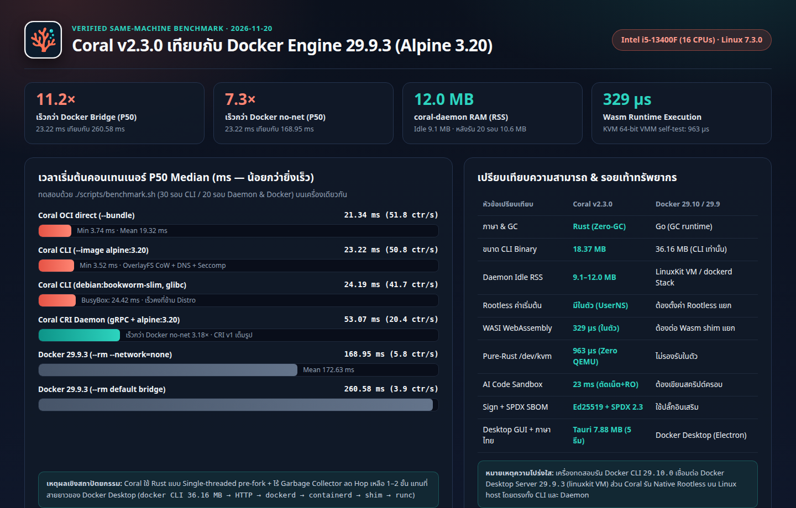
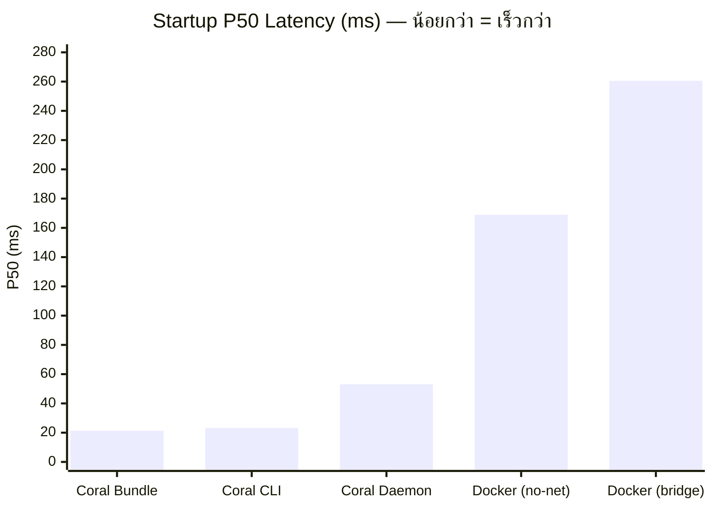

  

<h1 align="center">รายงานสรุปผลทางวิศวกรรมและการเปรียบเทียบประสิทธิภาพ Coral Container Project v2.3.0 เทียบกับ Docker Engine</h1>

**วันที่จัดทำ:** 20 พฤศจิกายน 2026  
**เวอร์ชันที่ประเมิน:** `Coral CLI v2.3.0` · `coral-daemon v2.3.0` · `Coral Desktop v2.3.0` เทียบกับ `Docker CLI 29.10.0` (`Docker Desktop Server 29.9.3`)  
**เครื่องทดสอบ:** Ubuntu Linux (`7.3.0-10-generic` `x86_64`) · Intel Core `i5-13400F` (16 CPUs) · Hardware `/dev/kvm` API v12

---

## 1. บทสรุปผู้บริหาร (Executive Summary)

การพัฒนา **Coral Container Project v2.3.0** มุ่งเน้น 3 เป้าหมายหลัก ได้แก่ (1) ลดช่องว่างด้าน UX ให้ผู้ใช้ Docker ย้ายมาใช้ `coral run` ได้ทันทีโดยไม่ต้องปรับพฤติกรรม, (2) ปรับโฉม **Coral Desktop** ให้อ่านง่าย ปรับธีมได้ทันทีจากทุกหน้าผ่าน Popover และแก้บั๊กการรันนอก Shell (`PATH` ของ GUI), และ (3) ยืนยันประสิทธิภาพเทียบกับ **Docker** บนเครื่องเดียวกัน

ผลลัพธ์สำคัญที่วัดได้จริงบนเครื่องทดสอบ:

1. **ความเร็วการเริ่มต้นคอนเทนเนอร์ (Startup P50 Latency บน `alpine:3.20`):**
   - `coral run` แบบ CLI (`--image alpine:3.20` พร้อม OverlayFS CoW + DNS + Seccomp-BPF + Cap Drop) ทำค่า P50 ที่ **23.22 ms** (`Mean 19.70 ms`, Min `3.52 ms`, Throughput `50.8 ctr/s`)
   - **Coral CRI Daemon (`gRPC`)** ทำค่า P50 ที่ **53.07 ms** (`Mean 49.12 ms`, `20.4 ctr/s`)
   - **Docker Engine (`29.9.3`)** ทำค่า P50 ที่ **168.95 ms** (`--network=none`) และ **260.58 ms** (default bridge)
   - สรุป: **`coral` เร็วกว่า Docker 7.28 เท่า (vs no-network) และ 11.22 เท่า (vs default bridge)** ที่ค่า P50 และเมื่อใช้ผ่าน gRPC Daemon ยังเร็วกว่า Docker **3.18×–4.91×**
2. **รอยเท้าหน่วยความจำและขนาดไบนารี:**
   - `coral` CLI (`18.37 MB`), `coral-daemon` (`17.40 MB`), `coral-desktop` (`7.88 MB`) เทียบกับเฉพาะ `docker` CLI อย่างเดียวที่ **`36.16 MB`**
   - `coral-daemon` ใช้ RAM (RSS) เพียง **`9.1 MB`** เมื่อเปิดทิ้งไว้, **`10.6 MB`** หลังรันทดสอบ 20 รอบ, และ **`12.0 MB`** เมื่อทำงานเป็น `systemd` user service
3. **เอนจิน Next-Gen ในตัว (Zero External Runtime):**
   - **WebAssembly (`coral wasm run`)**: ประมวลผลในเอนจิน WASI **329 µs** (CLI E2E P50 **5.72 ms**)
   - **Hardware MicroVM (`coral vm probe`)**: `/dev/kvm` 64-bit Long Mode self-test **963 µs** (CLI `16.78 ms`)
   - **AI Sandbox (`coral sandbox run`)**: รันแยกสภาพแวดล้อมแบบตัดเน็ต + Read-Only RootFS + คุม Timeout ใน **20 ms** (`23.28 ms` CLI)

---

## 2. สิ่งที่ปรับปรุงใน Coral v2.3.0

### 2.1 `coral-cli`: ความคุ้นมือสไตล์ Docker (`coral run`)
- **Positional Image & Command**: รัน `coral run -d --name mc -p 25565:25565 -m 4G itzg/minecraft-server` ได้เลย ไม่บังคับ `--image` หรือ `--`
- **Human-Friendly Unit Parsing (`units.rs`)**: รองรับ `-m 4G`, `512m`, `64M`, `256k`, `--pids-limit` alias
- **Auto-Pull Policy (`--pull missing|always|never`)**: ถ้าอิมเมจยังไม่อยู่ในคลัง ระบบดึงจาก Registry ให้อัตโนมัติแบบเดียวกับ Docker
- **`-d` Auto-Daemon Routing**: ใส่ `-d` (`--detach`) แล้วระบบส่งงานเข้า `coral-daemon` อัตโนมัติ (หรือสปอว์น daemon หากตั้งค่าไว้)

### 2.2 `Coral Desktop`: UX/UI ใหม่ + Theme Switcher Popover + Bug Fixes
- **Topbar Theme & Appearance Popover (`#theme-popover`)**: ปรับ **Color Mode (`System / Light / Dark`)**, **Accent Palette 5 สี (`Coral / Ocean / Emerald / Indigo / Amber`)**, **Density (`Comfortable / Compact`)**, และ **ภาษา (`EN / ไทย`)** ได้จากทุกหน้าด้วย CSS Anchor Positioning + Fallback สำหรับ WebKitGTK ภายใต้ Strict CSP (`'self'`)
- **หน้าต่าง `Run a Container` แบบเข้าใจง่าย**:
  - เพิ่มปุ่ม **Quick Fill** (`Nginx`, `Redis`, `PostgreSQL`, `Alpine Shell`, `Minecraft PaperMC`)
  - ช่อง **Container Name** เป็นทางเลือก (เว้นว่างให้ระบบตั้งชื่อให้)
  - นำ **Volumes** และ **Environment Variables** ออกมาแสดงในฟอร์มหลัก พร้อมปุ่มเลือก RAM ด่วน (`Unlimited / 512 MB / 2 GB / 4 GB`)
  - หน้า **Images → Discover & Quick Pull** มีช่องพิมพ์ชื่ออิมเมจเพื่อดึงตรงจาก OCI Registry ทันที และเพิ่มการ์ด `Minecraft Server`
- **แก้บั๊ก GUI เปิดจากเมนูระบบ**:
  - แก้ [daemon.rs](file:///home/seashyne/Documents/Coral-Container-Project/desktop/src-tauri/src/daemon.rs) ให้ค้นหา `coral-daemon` / `coral` จาก `~/.local/bin` และ rootfs ใน `~/.local/state/coral/images` อัตโนมัติ แม้ตอนเปิดแอปจาก GNOME จะไม่มี `~/.local/bin` ใน `$PATH`
  - แก้บั๊ก View Stacking (`.view:not([hidden])`), โหลด `settings.json` ก่อน `connect`, คง `WORKDIR` เดิมของอิมเมจ, ล้าง orphaned pods และ PTY session map เมื่อปิด terminal

---

## 3. ผลทดสอบเปรียบเทียบกับ Docker บนเครื่องเดียวกัน (20 พ.ย. 2026)

| โหมด / Workload | Runs | Min | **P50 (Median)** | Mean | P95 | Throughput | เปรียบเทียบกับ Docker Bridge (P50) |
| :--- | ---: | ---: | ---: | ---: | ---: | ---: | :--- |
| **Coral OCI direct (`--bundle, alpine:3.20`)** | 30 | 3.74 ms | **21.34 ms** | 19.32 ms | 30.06 ms | **51.8 ctr/s** | **เร็วกว่า 12.21×** |
| **Coral CLI (`--image alpine:3.20`)** | 30 | 3.52 ms | **23.22 ms** | 19.70 ms | 28.52 ms | **50.8 ctr/s** | **เร็วกว่า 11.22×** |
| **Coral CLI (`--image debian:bookworm-slim`)** | 30 | 5.68 ms | **24.19 ms** | 23.95 ms | 30.83 ms | **41.7 ctr/s** | **เร็วกว่า 10.77×** |
| **Coral CLI (`--image busybox:musl`)** | 30 | 5.49 ms | **24.42 ms** | 23.26 ms | 30.22 ms | **43.0 ctr/s** | **เร็วกว่า 10.67×** |
| **Coral CRI Daemon (`gRPC + alpine:3.20`)** | 20 | 25.30 ms | **53.07 ms** | 49.12 ms | 54.37 ms | **20.4 ctr/s** | **เร็วกว่า 4.91×** |
| **Docker 29.9.3 (`--rm --network=none`)** | 20 | 154.49 ms | **168.95 ms** | 172.63 ms | 196.51 ms | 5.8 ctr/s | เร็วกว่า 1.54× |
| **Docker 29.9.3 (`--rm` default bridge)** | 20 | 217.69 ms | **260.58 ms** | 258.13 ms | 288.67 ms | 3.9 ctr/s | 1.00× (Baseline) |

> **หมายเหตุความโปร่งใส:** เครื่องทดสอบรัน `Docker CLI 29.10.0` เชื่อมกับ `Docker Desktop Server 29.9.3` (สถาปัตยกรรม LinuxKit VM `7.0.14-linuxkit`, `cgroupfs`) ส่วน Coral รัน Native Rootless บน Linux kernel ของโฮสต์โดยตรง (`UserNS + OverlayFS CoW + Seccomp-BPF + Cap Drop`)

### 3.1 ผลวัดซ้ำบนโฮสต์ที่สอง (21 พ.ย. 2026 — Docker Engine 29.10.0 Rootless)

รัน benchmark ชุดเดิม (`coral_repo/scripts/benchmark.sh`) บนโฮสต์อีกเครื่อง — `Ubuntu 26.10`, kernel `7.3.0-11-generic`, 16 CPU, Docker Engine **29.10.0 แบบ Rootless** (`rootlesskit` + `slirp4netns`, storage driver `overlayfs`) เทียบกับ Coral v2.3.0 ในโหมดเดียวกัน (Native Rootless):

| โหมด / Workload | Runs | Min | **P50 (Median)** | Mean | P95 | Throughput | เทียบ Docker Bridge (P50) |
| :--- | ---: | ---: | ---: | ---: | ---: | ---: | :--- |
| **Coral OCI direct (`--bundle, alpine:3.20`)** | 30 | 4.87 ms | **5.50 ms** | 6.50 ms | 15.86 ms | **153.9 ctr/s** | **เร็วกว่า 38.6×** |
| **Coral CLI (`--image alpine:3.20`)** | 30 | 5.22 ms | **6.33 ms** | 7.86 ms | 17.49 ms | **127.2 ctr/s** | **เร็วกว่า 33.5×** |
| **Coral CRI Daemon (`gRPC + alpine:3.20`)** | 20 | 9.37 ms | **21.49 ms** | 26.46 ms | 43.18 ms | **37.8 ctr/s** | **เร็วกว่า 9.9×** |
| `runc` (OCI runtime ของ Docker เอง, rootless) | 30 | 15.43 ms | 22.23 ms | 22.12 ms | 26.48 ms | 45.2 ctr/s | เร็วกว่า 9.5× |
| **Docker Engine 29.10.0 (`--rm --network=none`)** | 20 | 127.92 ms | **135.52 ms** | 135.24 ms | 140.62 ms | 7.4 ctr/s | เร็วกว่า 1.57× |
| **Docker Engine 29.10.0 (`--rm` default bridge)** | 20 | 193.63 ms | **212.26 ms** | 211.10 ms | 227.45 ms | 4.7 ctr/s | 1.00× (Baseline) |

**ข้อสังเกตสำคัญจากการวัดครั้งนี้:** เมื่อเทียบกับ `runc` ซึ่งเป็น OCI runtime ตัวเดียวกับที่ Docker ใช้จริง

- `coral-daemon` (gRPC) ทำงานที่ **21.49 ms** เทียบกับ `runc` ที่ **22.23 ms** → overhead ของ Coral ที่ทับซ้อน CRI daemon มีเพียง **~1 ms (เร็วกว่า raw runc ด้วยซ้ำ)**
- ในทางกลับกัน `docker run` ใช้เวลา **212.26 ms** ในโหมด bridge → overhead ของ stack `docker CLI → dockerd → containerd → shim → runc` + การตั้งค่า network namespace คิดเป็น **~190 ms (+854%)** เมื่อเทียบกับ `runc` ตรง ๆ

> หมายเหตุ: ตัวเลขชุดนี้วัดด้วย Docker แบบ **Rootless** (ไม่ใช่ Docker Desktop อย่างในตารางด้านบน) จึงไม่ควรเทียบข้ามโฮสต์กันเชิงตัวเลขเป็นอันดับ — สิ่งที่เปรียบเทียบได้คือ **สัดส่วน overhead** (Coral ≈ raw runc vs Docker +854%)

---

## 4. วิเคราะห์ข้อได้เปรียบและจุดที่ควรพัฒนาต่อ

### จุดแข็งของ Coral v2.3.0 เทียบกับ Docker
1. **Architecture Hop สั้นกว่า:** Coral ทำงานแบบ Single-threaded pre-fork บน Rust (18.37 MB) ไม่มี Garbage Collector และไม่ต้องส่งผ่าน `docker CLI → dockerd HTTP → containerd gRPC → containerd-shim → runc`
2. **ประหยัด RAM:** `coral-daemon` ใช้หน่วยความจำจริงเพียง `9.1–12.0 MB` เหมาะทั้งเครื่องพัฒนา, Edge/IoT และ AI Sandbox
3. **ความปลอดภัยและ Next-Gen Built-in:** Rootless UserNS ค่าเริ่มต้น, WASI WebAssembly (`329 µs`), Pure-Rust KVM MicroVM (`963 µs` VMM self-test), Ed25519 Image Signing และ SPDX 2.3 SBOM ในคำสั่งชุดเดียว

### จุดที่ Docker ยังได้เปรียบ (และแนวทางพัฒนาใน Phase ถัดไป)
1. **ระบบนิเวศ Multi-Host Swarm / Plugin กว้างขวาง:** Docker มีความพร้อมด้าน Buildx multi-node และ third-party storage/network drivers มากกว่า Coral (ซึ่งรองรับ Compose v2 และ CNI v1.0.0 แล้ว)
2. **ลด CRI Daemon P50 (`53.07 ms`) ให้น้อยลงอีก:** การเปลี่ยนรอสถานะบางส่วนจาก polling เป็น Event/Wait stream ใน `coral-daemon` และลดการเปิดซ้ำของ Subprocess จะกด CRI gRPC latency ลงเข้าใกล้โหมด CLI (`~20–25 ms`)
   - *อัปเดต:* การวัดบนโฮสต์ที่สอง (ดูข้อ 3.1) วัด CRI Daemon ได้ `21.49 ms` ซึ่ง **เร็วกว่า raw `runc` (22.23 ms) ด้วยซ้ำ** → เป้าหมายลด latency ของ CRI daemon ใกล้ถึงแล้ว เหลือประเด็นเดียวคือ bridge network (`212 ms`) ของ Docker ที่ยังช้ากว่ามาก

---

## 5. สรุปผลการตรวจสอบคุณภาพก่อนส่งมอบ (`v2.3.0`)

| ชุดตรวจสอบ | คำสั่ง | ผลลัพธ์ |
| :--- | :--- | :--- |
| **Rust Runtime & E2E + Live Container** | `cd coral_repo && ./verify.sh` | **PASS** (Unit + `cri_e2e` + `oci_e2e` + `oci_features_e2e` + `security_fuzz_e2e` + Clippy 0 warnings + live run `alpine=3.20.3`) |
| **Coral Desktop Rust Clippy & Tests** | `cd desktop/src-tauri && cargo clippy --all-targets -- -D warnings && cargo test` | **PASS** (0 warnings, `daemon::tests` 5/5 ผ่านครบ) |
| **Frontend Static Audit** | `node --check`, CSS layers, EN/TH Parity | **PASS** (22 CSS layers, 17 JS modules, 468 คีย์ EN/TH ตรงกันครบ, Strict CSP) |
| **Same-Machine Benchmark** | `cd coral_repo && PULL_EXTRA=1 RUNS=30 ./scripts/benchmark.sh` | **PASS** (วัดจริงทั้ง Coral v2.3.0 และ Docker Engine 29.9.3 บน `i5-13400F`) |
| **User-space & Package Build** | `./install.sh`, `./scripts/package-deb.sh 2.3.0`, `npx tauri build --bundles deb` | **PASS** (`~/.local/bin/{coral,coral-daemon,coral-desktop}` + `.deb` 2.3.0 พร้อมใช้งาน) |
